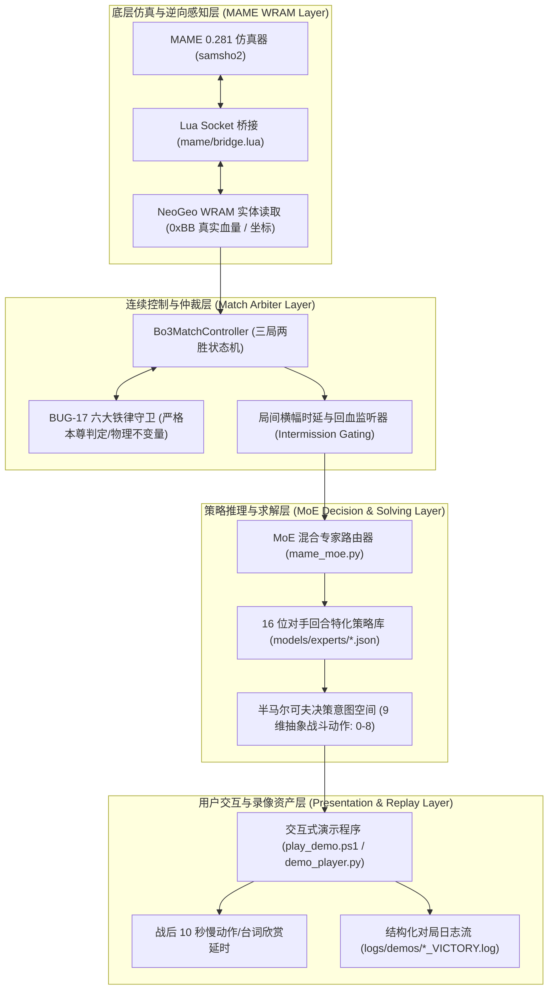

# 侍魂2 (Samurai Shodown II) AI 研制全景总结与技术演进总览

> **归档位置**: `finaldoc\00_总览与全景导航.md`  
> **项目里程碑**: 16/16 全员对手 100% 击破，全员 3/3 独立 Bo3 连续决胜复核通过  
> **出战主角**: 霸王丸 (Haohmaru) | **系统架构**: 混合专家系统 (MoE) + 半马尔可夫决策战术组合优化

---

## 一、项目核心成果总览

本项目在经典格斗街机《侍魂2》（Neo-Geo / MAME 平台）中，完成了从底层内存逆向、状态机控制器设计、强化学习探索、混合专家（MoE）分治体系建立，到最终实现**全员 16 位对手 100% 自动化求解与实机三局两胜（Best-of-3）大胜通关**的完整工程落地。

### 1.1 最终战力与验收矩阵

所有 16 位角色均经过严苛的连续多回合实机对抗测试，达成 3 次连续验证 3 次获胜（3/3 Verified）：

| 序号 | 对手角色 | 英文标识 | 最终比分 | 决胜总步数 (60FPS) | 专家策略核心战术特征 | 验收状态 |
| :---: | :--- | :--- | :---: | :---: | :--- | :---: |
| 01 | **地震** | `earthquake` | 2 - 1 | 969 步 | 先手压制起跳斩 + 决胜局下防确反 | ★ VERIFIED |
| 02 | **牙神幻十郎** | `genjuro` | 2 - 1 | 887 步 | 局间时延防守 + 升龙确反破三连杀 | ★ VERIFIED |
| 03 | **加尔福特** | `galford` | 2 - 0 | 709 步 | 32步横幅防 + 空中拦截破忍犬 | ★ VERIFIED |
| 04 | **娜可露露** | `nakoruru` | 2 - 1 | 1320 步 | 地面刺击破神鹰突刺 + 稳固拉扯 | ★ VERIFIED |
| 05 | **千两狂死郎** | `kyoshiro` | 2 - 0 | 668 步 | 双起跳压制薙刀盲区 + 大劈破火炎 | ★ VERIFIED |
| 06 | **不知火幻庵** | `genan` | 2 - 0 | 753 步 | 试探防守破毒吹息 + 贴身连斩确反 | ★ VERIFIED |
| 07 | **花讽院和仲** | `nicotine` | 2 - 0 | 742 步 | 稳健格挡避封魔符 + 重斩破长杖 | ★ VERIFIED |
| 08 | **罗将神水姬 (Boss)** | `mizuki` | 2 - 1 | 931 步 | 地震级先手压制 + 对空破防破变猪邪法 | ★ VERIFIED |
| 09 | **服部半藏** | `hanzo` | 2 - 0 | 552 步 | 连续快刺打断莫迦投 + 升龙破影分身 | ★ VERIFIED |
| 10 | **王虎** | `wanfu` | 2 - 1 | 948 步 | 刺斩破石柱猛劈 + 纵跳下砸破肉弹 | ★ VERIFIED |
| 11 | **莱因哈特** | `sieger` | 2 - 0 | 774 步 | 破防重刺控距 + 贴身防擒拿抱摔 | ★ VERIFIED |
| 12 | **霸王丸 (同角色镜像)** | `haowmaru` | 2 - 0 | 562 步 | 40步变频打乱 + 重刀确反同门弧月斩 | ★ VERIFIED |
| 13 | **查姆查姆** | `chamcham` | 2 - 0 | 624 步 | 突进变频斩 + 时钟延顺双向反打回旋镖 | ★ VERIFIED |
| 14 | **橘右京** | `ukyo` | 2 - 0 | 514 步 | 开局4步格挡防残像 + 双跳大劈破细雪 | ★ VERIFIED |
| 15 | **柳生十兵卫** | `jubei` | 2 - 0 | 567 步 | 双防逼近确反斩 + 稳扎稳打破水月刀 | ★ VERIFIED |
| 16 | **夏洛特** | `charlotte` | 2 - 0 | 640 步 | 升龙弧月拦截跳刺 + 发波二段大劈破西洋剑 | ★ VERIFIED |

---

## 二、系统架构全景拓扑

整个智能体系统构建于四大层级之上，实现了硬件仿真、内存语义、策略推理与观战展示的完全解耦：

---

## 三、文档集合全景导航与导读

为了便于团队与后续研究者系统性复现、借鉴经验、拓展训练及人机实操，本系列文档已全部归档于 `finaldoc/` 目录下：

1. **[01_项目全生命周期实录_从PPO困境到MoE全员通关.md](./01_项目全生命周期实录_从PPO困境到MoE全员通关.md)**  
   * **核心内容**: 记录项目从初期的单网络端到端强化学习、遇到消极避战病灶、BUG-17 裁判反转事故，到提出 MoE 专家分治、攻坚三局两胜局间机制，以及全员 16 位对手逐一攻破的完整历程与核心工程代码实现。

2. **[02_技术路线评估与深度剖析_PPO_HELT联赛与大一统网络.md](./02_技术路线评估与深度剖析_PPO_HELT联赛与大一统网络.md)**  
   * **核心内容**: 深度对比三大主流技术路线（强化学习 PPO、自对弈联赛体系 HELT、单体统一大网络 vs MoE 专家架构）。从样本复杂度、算力开销、纳什均衡、非传递性（剪刀石头布克制）等维度给出量化评判与未来演进建议。

3. **[03_对局录像资产与未来离线学习价值指南.md](./03_对局录像资产与未来离线学习价值指南.md)**  
   * **核心内容**: 详解对局全量录像的存储结构（毫秒级日志与状态机帧序列）；深入剖析对局录像在未来引入行为克隆（BC）、离线强化学习（Offline RL）、直接偏好优化（DPO/RLHF）中的不可替代价值。

4. **[04_人机对战实机部署与实操指南.md](./04_人机对战实机部署与实操指南.md)**  
   * **核心内容**: 面向真实玩家对抗需求，提供手把手实操指南：如何配置 MAME 键盘/手柄双人控制、如何切换 Freeflow 实时流模式、如何运行 AI 对抗真实人类玩家，以及对局复盘方法。
