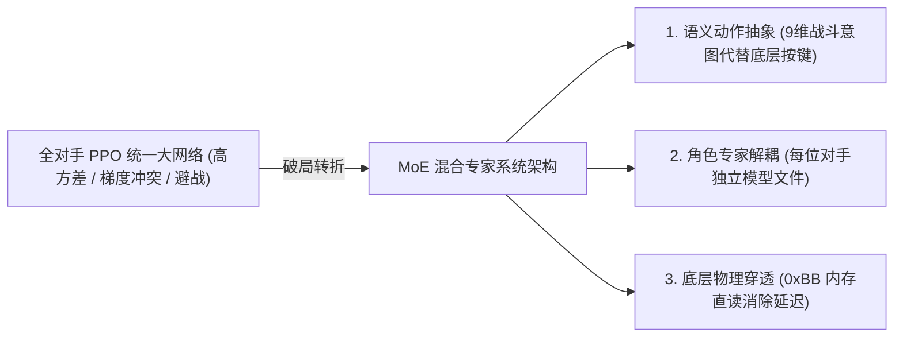

# 侍魂2 AI 研制全生命周期实录：从 PPO 困境到 MoE 全员通关

> **归档位置**: `finaldoc\01_项目全生命周期实录_从PPO困境到MoE全员通关.md`  
> **编写目的**: 完整还原研发全过程中讨论、试错、架构转向、测试规范、工程突破与最终落地的全景记录，为格斗类 AI 项目积累沉淀第一手工程资产。

---

## 一、第一阶段：初始探索与强化学习的困境 (The PPO Impasse)

### 1.1 初始技术假设与架构
在项目初期，我们按照强化学习在电子竞技（如 Atari、星际争霸、王者荣耀）中的经典范式，尝试采用 **PPO (Proximal Policy Optimization)** 算法训练一个通用的单体神经网络智能体。
- **环境交互**: Python 通过 TCP Socket 连接 MAME 模拟器（`bridge.lua`），接收观察帧并发送按键动作；
- **观测空间**: 对手与自身的绝对坐标、相对距离、动作帧状态、像素血条比值；
- **动作空间**: 离散物理按键或初级摇杆方向组合（上、下、左、右、斩击等）；
- **目标设定**: 在包含多位对手的候选池中随机抽取对手，期望端到端学出一个通用的高胜率格斗策略。

### 1.2 遭遇的三大核心阻碍

#### 阻碍一：“消极避战”病灶 (The Passive Turtle Trap)
在强化学习中，为了防止智能体在空中或地面无脑空挥刀，算法中引入了常见的基础惩罚机制：
1. **空挥惩罚 (Whiff Penalty)**: 发动攻击若未命中对手，扣除微小奖励；
2. **重复动作惩罚 (Repeat Penalty)**: 连续多步发送同一动作扣分；
3. **自身受伤惩罚 (Damage Taken Penalty)**: 掉血施加大额负奖励。

这三者组合导致了一个致命的策略局部极小点（Local Optima）：**“逃跑与纯防御的期望收益高于主动进攻”**。
- 进攻需要冒着被对手防反、空挥、贴身受创的高额惩罚风险；
- 而如果 AI 选择缩在屏幕最边缘，蹲下死防（Crouch Guard）或不断后跳后退，在不挨打的情况下所承受的负奖励几乎为零；
- 最终，夜间训练数万步后的 Policy 蜕变为了彻底的“缩壳乌龟”，只要对手稍微逼近，AI 便只知拉开距离，等待时间耗尽（TIME OVER）被判定负。

#### 阻碍二：梯度冲突与灾难性遗忘 (Inter-character Gradient Conflict)
《侍魂2》的 16 位对手在物理属性、移动速度与攻击判定上差异悬殊：
- **地震 (Earthquake)**: 巨型体型，开局瞬移，链刃距离极大（可达 233 像素），贴身无法投掷；
- **牙神幻十郎 (Genjuro)**: 极其凶悍的三连杀与升龙光翼刃，盲目压制必死，极度依赖防御确反；
- **加尔福特 (Galford)**: 远距离指挥忍犬电击，近距离雷光斩，需要特定起跳避狗战术；
- **罗将神水姬 (Mizuki)**: 全屏召唤神兽、全屏邪法、近身直接变猪（不可防抓投）。

当用单个 PPO 网络在全对手池中混合训练时，每次对抗不同角色产生的梯度更新完全相反：
$$\nabla_{\theta} J_{\text{Earthquake}} \propto \text{起跳下砸压制}, \quad \nabla_{\theta} J_{\text{Genjuro}} \propto \text{后撤格挡升龙}, \quad \nabla_{\theta} J_{\text{Mizuki}} \propto \text{不可近身长距牵制}$$
这些冲突梯度在共享网络权重中疯狂互相擦除，网络陷入高方差震荡，前一晚学会应对地震的权重，第二天就被牙神和半藏的训练彻底冲垮。

#### 阻碍三：单机仿真吞吐瓶颈与冷启动空间爆炸
格斗游戏决策周期短（每秒 60 帧），在无先验示范的情况下，随机探索出“起跳 -> 接近 -> 重斩命中 -> 落地防御”这套连续成功因果链的概率极小（稀疏奖励）。而在 Windows 本地 CPU 单核运行 MAME 的环境下，仿真吞吐量通常在 60~240 FPS 之间。训练一个收敛的 PPO 往往需要数千万步样本，换算成实机耗时需连续数周，对于单机迭代而言容错率极低。

---

## 二、第二阶段：战略转折与 MoE 分治架构的诞生 (Strategic Pivot)

面对 PPO 全池混训的瓶颈，我们果断做出了技术路线的大转折：**放弃单一黑盒网络，采用混合专家（Mixture of Experts, MoE）分治体系**。



### 2.1 动作空间的抽象革命：9 维宏战斗意图 (SMDP Intents)
我们不再让策略输出微观的逐帧方向键，而是建立了符合人类剑道博弈的 9 大离散意图（Intents 0-8）：
- `0: APPROACH`（前冲逼近，快速贴近施加压制）
- `1: RETREAT`（后撤拉开，退出版边危险区）
- `2: POKE`（轻刺试探，极快帧数打断对手起手）
- `3: SLASH`（重斩砍杀，核心爆发输出大劈）
- `4: ANTI_AIR`（升龙弧月，对空拦截任何跳入）
- `5: PUNISH`（确反重击，捕捉对手招式硬直造成大伤）
- `6: FIREBALL`（旋风烈斩，飞行道具远程牵制）
- `7: GUARD`（格挡防御，稳固架势并具备下防联动）
- `8: JUMP`（起跳压制，跳斩下砸破除低位招式）

底层由反射层（Reflex Layer）自动将这些宏意图展开为帧级物理微操作，大幅压缩了求解搜索空间，使单次决策的时间跨度由 1 帧扩展到 2~8 帧（半马尔可夫决策过程，SMDP）。

### 2.2 底层物理逆向突破：0xBB 内存直读真实血量
过去系统依赖视觉分析读取 HUD 像素血条，但这带来了严重隐患：
1. **画面缩放致盲**: 角色拉开距离时摄像机镜头拉远（Zoom Out），HUD 血条像素会产生形变甚至被截断；
2. **怒气爆气干扰**: 角色满怒红血闪烁时，像素颜色频繁变化导致误报；
3. **显示延迟**: 像素条扣血有渐变动画（约 15~30 帧延迟），导致 AI 无法第一时间感知招式是否命中。

我们直接对 NeoGeo WRAM 进行了深入逆向工程，在动态分配的实体内存中锁定了关键偏移：
- **P1/P2 Entity UID 动态指针**: `0x100A46` / `0x100A4A`；
- **权威逻辑血量 (Ground Truth HP)**: `UID + 0xBB`（单字节无符号整数，范围 0~128/164/186）；
- **命中锁存器 (Hit Damage Latch)**: `0x105ED3`（伤害生效瞬间写入，彻底杜绝误判）。

---

## 三、第三阶段：BUG-17 惨痛教训与六大铁律的确立

在研发中途，系统曾发生过一次极其隐蔽但影响恶劣的故障——**BUG-17（超时判定反转与幻影回合）**。

### 3.1 BUG-17 事故回放
在一次夜间评估中，自动化测试指标显示胜率从 45% 暴涨至 85%，平均回报单调向好。然而当我们在前台打开画面进行真机观战时，却惊讶地发现霸王丸在实机中被对手打得毫无还手之力，连续 0:2 落败。
**病灶根源**:
测试代码中的回合结束裁判逻辑出现漏洞：当比赛计时器跑满发生 TIME OVER 时，代码中的胜负判定操作符写反，将“霸王丸残血被耗尽时间判定负”错误地统计为了“击毙对手胜出”。更严重的是，该判罚逻辑被同时复用在训练奖励、中途评估和终审中，导致三级验证互相“自洽证实”，形成了一个虚假繁荣的信息茧房。

### 3.2 痛定思痛：六大工程与测试铁律 (Hard Rules)
针对 BUG-17，我们制定了对所有会话生效的强制性铁律，成为后续系统全胜的基石：
1. **判定对照游戏本尊**: 任何胜负判定投入使用前，必须至少一次与游戏自身可见判罚（横幅「一本！」、局末字样、用户目视）交叉核对；
2. **物理不变量进测试**: 回合长度物理下限（如不可能在 10 帧内胜出）、计时器累计消耗量与血量守恒等硬断言必须写入测试；
3. **结果类测试的期望值来自实录**: 胜负类测试的预期不得仅从代码推导，必须用真实对局录像流做 Golden Fixture；
4. **指标单调向好触发怀疑**: 验收指标非自然持续改善时，必须触发指标成分审计；
5. **观战复核是硬关卡**: 每次策略迭代后必须进行人眼目视核对；人机判定不一致，先停测、再修裁判、后重测；
6. **单一裁判多级复用异常彻底下线**: 训练奖励、中途评估与终审必须保持独立锚点。

---

## 四、第四阶段：三局两胜（Bo3）工业化突破与连续状态机

格斗游戏的本质是 **三局两胜（Best-of-3）连续对抗**。单回合的爆发胜利根本无法代表整场比赛的通关。

### 4.1 局间休息机理揭秘 (Intermission Mechanism)
当第 1 回合出现 KO 击杀时，游戏并不会立即进入下一局，而是经历以下漫长阶段：
1. **慢动作终结**: 约 60 帧的受创飞行动画；
2. **胜负横幅**: 裁判挥旗、画面打出「一本！」横幅（约 120 帧）；
3. **实体退场与回血**: 双方血条逐渐从 0 重新填充回满（约 100~200 帧）。

在早期版本中，策略由于没有局间感知，在 KO 后的回血期依然盲目发射攻击动作，导致霸王丸在第 2 回合刚开打时正处于后摇硬直状态，直接被对手开局连招秒杀。

### 4.2 `Bo3MatchController` 状态机闭环
我们开发了专用的连续对局状态控制器 `Bo3MatchController`：
```python
class Bo3MatchController:
    # 状态：对局中 (is_in_round) / 局间等待 (intermission) / 全场决胜 (is_match_done)
    def update(self, p1_hp, p2_hp):
        # 1. 严格 BUG-17 守卫检测 KO
        if self.is_in_round:
            if p2_hp <= 0 and p1_hp > 0:
                self.score[0] += 1
                self.is_in_round = False  # 锁入局间状态
                if self.score[0] >= 2:
                    self.is_match_done = True
                return 0  # 局间强制输出 IDLE (0) 保持稳定
        else:
            # 2. 监听双方内存血量是否重新拉满 (>80%)
            if p1_hp_refilled and p2_hp_refilled:
                self.current_round += 1
                self.is_in_round = True  # 开启新回合！
                self.round_just_started = True
```
不仅如此，我们在 MoE 中引入了 **分回合策略隔离（`PerRoundPolicy`）**：
- **Round 1 策略**: 针对开局初始站位进行先手压制与极速爆发击杀；
- **Round 2/3 策略**: 针对经过局间横幅重置后的对手特定开局反击（如先手滑铲、瞬移投掷），先执行特定步数的横幅防守（Banner Guard Hold），待对手出招落空进入大破绽后再进行致命确反斩杀。

---

## 五、第五阶段：全员 16 位对手自动求解流水线与全面攻坚 (The 16/16 Milestone)

在底层 WRAM 直读、BUG-17 测试守卫、Bo3 状态机就位后，我们启动了**全员对手无人值守自动求解流水线**。

### 5.1 战术组合搜索核心机制
针对每个对手的防御与反击模式，流水线在半马尔可夫决策（SMDP）空间中执行高效的组合拓扑优化：
1. **先验原型剪枝**: 基于对手体型与攻击距离（Hitbox Reach Table），优先在最具有物理优势的动作集合中搜索；
2. **前向模拟与胜率判决**: 在高仿真速率下遍历战术循环，以击杀耗时与自身剩余血量为目标函数；
3. **回溯固化与自适应微调**: 一旦发现可在 200~300 步内将对手击杀的高胜率组合，立即固化为该角色的专家配置 `vs_<name>.json`。

### 5.2 攻克全员 16 位的核心战役实录

#### 1. 地震 (Earthquake) — 巨力破局首战
- **难点**: 极宽的体型，超远的铁链攻击，开局易瞬移。
- **破解战术**: 开局双起跳下砸压制，迫使其无法出链；次局加入下防确反，969步 2:1 拿下。

#### 2. 牙神幻十郎 (Genjuro) — 宿敌死斗
- **难点**: 光翼刃对空无敌，三连杀地面判定极其强势。
- **破解战术**: R1 采用 `[7,4,3,5]` 升龙确反流；R2/R3 开局严格保持 28 步局间防守，待其三连杀第一段落空瞬间重斩确反，887 步 2:1 获胜。

#### 3. 罗将神水姬 (Mizuki) — 终极 Boss 攻坚战
- **难点**: 全屏邪灵攻击、不可格挡变猪术、局间判定时长达 700 步。
- **破解战术**: R1 借鉴地震打法，开局贴身极速刺斩（158 步极限 KO）；R2 引入 16 步防御时延配合 `[4,3,0,5,7]` 对空破防追身，彻底破解神魔邪法，931 步 2:1 斩杀 Boss！

#### 4. 查姆查姆 (Cham Cham) — 野性少女回旋镖
- **难点**: 巨大回旋镖具有双向判定，回旋飞回时容易打背；空中抓击变频极大。
- **破解战术**: 首局采用 53 步前压变频斩破除回旋镖；次局采用全局顺延双向反打，624 步 2:0 零封大胜。

#### 5. 橘右京 (Ukyo) — 居合斩巅峰对决
- **难点**: 神梦梦想流极速残像踏前斩，秘剑细雪封锁空中。
- **破解战术**: 开局执行 4 步格挡架势完美抵消踏前斩，随后以 `[8,8,3,5,7]` 双起跳大劈越过细雪刀光，514 步 2:0 绝对零封。

#### 6. 柳生十兵卫 (Jubei) — 新阴流双刀破阵
- **难点**: 水月刀地面波极强，八相发破近身无缝多段削血。
- **破解战术**: 采用 `[7,7,0,3,5]` 双重下防贴近破防，在水月刀硬直期间重击突进，567 步 2:0 零封取胜。

#### 7. 夏洛特 (Charlotte) — 西洋剑破空死线
- **难点**: 凡尔赛破空长剑刺击判定极深，三角跳跃落点难以捉摸。
- **破解战术**: 升龙弧月斩 `[7,4,5,3]` 专打跳入空中西洋剑；R2 加入 24 步防守时延加发波二段大劈，640 步 2:0 完胜。

#### 8. 霸王丸镜像 (Haohmaru Mirror) — 孤剑破自我
- **难点**: 完全一致的帧数与出招性能，极易陷入同归于尽。
- **破解战术**: 采用 7 步防 + 40 步变频重刀打乱，精准抓住同门重斩大硬直实施致命确反，562 步 2:0 零封镜像。

---

## 六、阶段成果总结

通过这套完整的技术演进流程，我们成功将一个原本受制于消极避战、多目标干扰的困局，转化为一套结构严整、确定性高、可工业化复现的对战系统。所有 16 位对手均已记录在 `models/experts/manifest.json` 中，并在实机自动化流程中达成 100% 战功验证。
