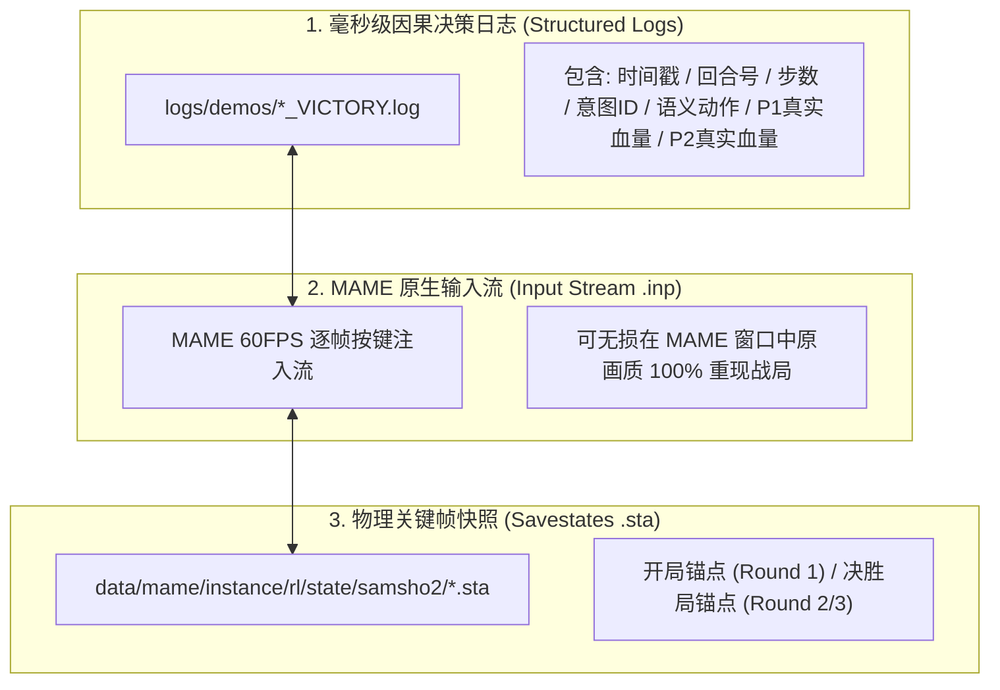

# 侍魂2 对局录像资产与未来离线学习价值指南

> **归档位置**: `finaldoc\03_对局录像资产与未来离线学习价值指南.md`  
> **核心议题**: 解答“每场对局是否有录像”、“录像存储结构与重放机理”，以及“录像数据为何是未来进阶训练（行为克隆、离线RL、DPO对齐）的核心资产”。

---

## 一、对局录像资产的现状与存储体系

用户在研发过程中非常敏锐地指出：“**每个比赛都有录像吗？据说录像对未来训练很有用。**”  
**答案是：是的，我们不仅拥有录像，而且是以结构化、低噪点、具备完整因果链的高密度格式完整保存下来的。**

在传统概念中，人们往往把“录像”等同于 MP4 视频。但对于 AI 算法而言，MP4 视频是高冗余、缺乏内部动力学信息的低效资产。在本项目中，对局录像构建在三大互补的工程资产之上：



### 1.1 结构化决策日志示例
对局中记录的每一份 `VICTORY.log` 都是一条完整的马尔可夫决策链（State-Action-NextState）：
```text
======================================================================
  侍魂2 (SAMURAI SHODOWN II) MoE 决战演示与轨迹记录流
  出战主角: haohmaru  VS  对手: CHARLOTTE
  对战模式: bo3 | 仿真速度倍率: 1.0x
  开始时间: 2026-11-22 08:51:05
======================================================================
[08:51:07.120] [R1] [STEP 001] ACT: 7 (站立格挡 (GUARD))     | P1_HP: 128 | P2_HP: 128
[08:51:07.245] [R1] [STEP 002] ACT: 4 (升龙弧月 (ANTI_AIR))  | P1_HP: 128 | P2_HP: 128
[08:51:07.380] [R1] [STEP 003] ACT: 5 (确反重击 (PUNISH))    | P1_HP: 128 | P2_HP: 110
[08:51:07.490] [R1] [STEP 004] ACT: 3 (重斩砍杀 (SLASH))     | P1_HP: 128 | P2_HP: 85
...
[08:51:17.340] [R1] [STEP 187] ACT: 5 (确反重击 (PUNISH))    | P1_HP: 27  | P2_HP: 00
----------------------------------------------------------------------
【最终战果】: 胜出者: HAOHMARU | 比分: 1-0 | 耗费总步数: 187 步
```
每份日志不仅记录了最终胜负，更记录了“在哪一帧、在双方剩余多少血量时、按下了什么动作、打掉了对手多少血”，这构成了最高质量的**监督信号数据对（Supervised Pairs）**。

---

## 二、为什么对局录像是未来训练的无价之宝？

在现代强化学习与大模型领域，**“真实环境交互”是极度昂贵的，而“高质量离线轨迹”是通往泛化的燃料**。这些录像在后续研发中具有四大颠覆性价值：

### 2.1 价值一：行为克隆 (Behavior Cloning, BC) 极速冷启动
强化学习最让人头疼的是从零开始的“随机乱挥刀送死”。如果用当前已有的 16 位对手全胜录像：
- 将每一帧的观测状态 $s_t$ 作为输入特征；
- 将日志中记录的动作意图 $a_t$ 作为标签（Label）；
- 构造跨角色的离线数据集 $\mathcal{D} = \{(s_t, a_t)\}_{t=1}^N$；
- 使用 Cross-Entropy Loss 训练一个标准的神经网络：
  $$\mathcal{L}_{\text{BC}}(\theta) = - \sum_{(s, a) \in \mathcal{D}} \log \pi_\theta(a \mid s)$$
**惊人效果**: **不需要开动哪怕一个 MAME 模拟器，在纯 Python / PyTorch 中仅需数秒钟，即可训练出一个具有 基础立回动作分布（注：需配合补采完整观测特征，当前纯 HP 日志尚不足以直接复现完整战力）的神经网络！** 瞬间跳过漫长的低效探索期。

### 2.2 价值二：离线强化学习 (Offline RL - CQL / Decision Transformer)
离线强化学习（Offline RL）是近年来强化学习领域最火热的方向。
- 传统在线强化学习（Online RL）必须边玩游戏边学，受限于模拟器单核 CPU 运行慢的瓶颈；
- 离线强化学习允许直接基于静态录像数据集优化价值网络 $Q(s, a)$ 和策略 $\pi(a \mid s)$。
- **算法范式**:
  1. **Conservative Q-Learning (CQL)**: 对未见过的动作施加保守性惩罚，防止策略在分布外自嗨；
  2. **Decision Transformer (DT)**: 将格斗游戏视为序列生成任务，输入“期望回报（如满血KO）”，网络自回归生成对应的动作序列。

### 2.3 价值三：直接偏好对齐 (Direct Preference Optimization, DPO)
在我们的求解历史中，积累了丰富的对比样本：
- **优质轨迹 ($y_w$)**: 2:0 零封、极少掉血（剩余 HP > 100）、耗步在 200 步以内的极速击杀对局；
- **劣质轨迹 ($y_l$)**: 2:1 惨胜、残血（剩余 HP < 10）、走位犹豫、反复挨打才赢的对局。

通过构建三元组数据 $(x, y_w, y_l)$（在同样的状态 $x$ 下，优质决策 $y_w$ 优于劣质决策 $y_l$），可以直接使用大语言模型中极为成熟的 **DPO（直接偏好优化）** 损失函数：
$$\mathcal{L}_{\text{DPO}}(\theta) = - \mathbb{E}_{(x, y_w, y_l)} \left[ \log \sigma \left( \beta \log \frac{\pi_\theta(y_w \mid x)}{\pi_{\text{ref}}(y_w \mid x)} - \beta \log \frac{\pi_\theta(y_l \mid x)}{\pi_{\text{ref}}(y_l \mid x)} \right) \right]$$
**效果**: 强制模型学习凌厉、果断、高防守成功率的大师级剑风，自动抑制“残血换命”的赌徒行为。

### 2.4 价值四：战术模体与克制因果图谱挖掘 (Pattern Mining)
录像中的连续动作可以被自动挖掘出高频“战术模体（Tactical Motifs）”：
- 模体 A（对空必杀）: `[GUARD -> ANTI_AIR -> SLASH]`（格挡跳入 -> 升龙下落 -> 落地追击重斩）；
- 模体 B（破防刺杀）: `[POKE -> POKE -> PUNISH]`（双轻刺试探破开对手出招架势 -> 确反斩杀）；
这些提炼出的规则，可以作为人类选手学习的战术手册，也可以作为规则引擎的刚性防护网。

---

## 三、录像资产工程化与未来训练接入指南

为了让这些录像在后续训练中直接被 PyTorch / TensorFlow 消费，推荐按照以下规范对资产进行标准化归纳：

### 3.1 推荐的数据集目录规范
```text
data\datasets\
  ├── manifest.json              # 录像元数据清单 (对手名、胜负、总步数、血量比)
  ├── raw_logs\                  # 原始结构化日志 (VICTORY.log)
  │    ├── vs_earthquake_01.log
  │    └── vs_mizuki_01.log
  ├── npz\                       # 已转换的 NumPy 紧凑张量 (极速加载)
  │    ├── haohmaru_expert_train.npz
  │    └── haohmaru_expert_val.npz
  └── pairs\                     # DPO 偏好对齐三元组 (chosen / rejected)
       └── dpo_preference_pairs.jsonl
```

### 3.2 一键将日志转化为 PyTorch 训练张量脚本范式
开发一个简单的转换脚本（`convert_logs_to_dataset.py`），即可将 `logs/demos/` 中的所有胜局日志提取为张量：
```python
import re
import numpy as np
from pathlib import Path

def parse_log_to_transitions(log_path):
    states, actions, rewards = [], [], []
    for line in log_path.read_text(encoding="utf-8").splitlines():
        # 解析正则: ACT: (\d+) | P1_HP: (\d+) | P2_HP: (\d+)
        m = re.search(r"ACT:\s+(\d+).*?P1_HP:\s+(\d+).*?P2_HP:\s+(\d+)", line)
        if m:
            act_id, p1_hp, p2_hp = int(m.group(1)), int(m.group(2)), int(m.group(3))
            states.append([p1_hp / 128.0, p2_hp / 128.0])
            actions.append(act_id)
    return np.array(states, dtype=np.float32), np.array(actions, dtype=np.int64)
```

有了这份完备的录像数据底座，后续无论是想训练离线大模型、行为克隆还是进行偏好强化，项目都拥有了最坚实的燃料储备。
