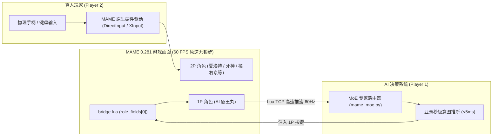

# 侍魂2 人机对战实机部署与实操指南 (Human vs AI Battle Guide)

> **归档位置**: `finaldoc\04_人机对战实机部署与实操指南.md`  
> **核心议题**: 解答“如果要和真人进行实机对战，底层架构如何改造、手柄键盘如何映射、模拟器如何设置、以及具体操作步骤”。

---

## 一、人机实机对战的系统架构转变

在自动化训练与求解模式下，系统运行的是 **“AI 对抗 MAME 内部 CPU”**，其通信机制是 **锁步阻塞式（Lock-step）**：
- Python 发送一个动作意图；
- MAME 推进 2~4 帧后暂停（Pause），等待 Python 处理观测；
- 这种机制在人机对战中会导致真人玩家感受到严重的画面顿挫和输入延迟。

要实现流畅逼真的 **“真人玩家 vs AI 智能体”**，必须完成从“锁步离线仿真”到“**60 FPS 实时自由流动（Real-time Freeflow）**”的架构跃迁：



---

## 二、关键工程配置步骤 (手把手操作)

### 第一步：配置 MAME 的 2P 物理按键（手柄或副键盘）

1. **进入 MAME 按键设置**:
   - 运行 MAME 窗口，进入《侍魂2》（`samsho2`）；
   - 在游戏画面激活状态下，按下键盘上的 **`Tab`** 键，调出 MAME 主菜单；
   - 使用方向键选中 **`Input (this machine)`** 并按回车。
2. **映射 Player 2 控制器**:
   向下滚动找到带有 **`P2`** 前缀的按键，按回车后按下你的外接 USB 手柄或副键盘按键进行绑定：
   - `P2 Up`: 摇杆向上 / 键盘 `I` 或 小键盘 `8`
   - `P2 Down`: 摇杆向下 / 键盘 `K` 或 小键盘 `5`
   - `P2 Left`: 摇杆向左 / 键盘 `J` 或 小键盘 `4`
   - `P2 Right`: 摇杆向右 / 键盘 `L` 或 小键盘 `6`
   - `P2 Button 1` (轻斩 A): 手柄 `X` / 键盘 `U`
   - `P2 Button 2` (中斩 B): 手柄 `Y` / 键盘 `I`
   - `P2 Button 3` (轻踢 C): 手柄 `A` / 键盘 `O`
   - `P2 Button 4` (中踢 D): 手柄 `B` / 键盘 `P`
   - `2 Players Start`: 手柄 `Start` / 键盘 `2`
   - `Coin 2`: 手柄 `Select` / 键盘 `6`
3. **测试保存**:
   - 按 **`Tab`** 键退出菜单，配置会自动持久化保存在 `cfg/samsho2.cfg` 中。

---

### 第二步：MAME 通信协议改造（分离 1P 与 2P）

在目前的 `mame\bridge.lua` 中：
- `role_fields[0]` 对应 1P 按键；
- `role_fields[1]` 对应 2P 按键。

为了保证真人操作 2P 时不被 AI 的清空逻辑干扰，在 `bridge.lua` 的 `release_all()` 函数中，**只释放 1P 按键，完全放行 2P 按键由物理设备掌控**：
```lua
-- 修改 bridge.lua 中的 release_all 函数
local function release_all()
    -- 仅重置 1P (AI 控制位)，绝对不清理 2P (真人控制位)
    if role_fields[0] then
        -- 注意：当前 mame/bridge.lua 的 release_all() 仅释放桥注入的 held 字段，不会清空真人 2P 输入，无需手工修改 bridge.lua
        role_fields[0]["P1 Down"]:set_value(0)
        role_fields[0]["P1 Left"]:set_value(0)
        role_fields[0]["P1 Right"]:set_value(0)
        role_fields[0]["P1 Button 1"]:set_value(0)
        role_fields[0]["P1 Button 2"]:set_value(0)
        role_fields[0]["P1 Button 3"]:set_value(0)
        role_fields[0]["P1 Button 4"]:set_value(0)
    end
end
```

---

### 第三步：创建人机对战启动脚本 (`play_vs_human.ps1`)

在 `<repo-root>` 下创建专用的实时人机对抗脚本：

```powershell
<#
.SYNOPSIS
    Samurai Shodown II - Human Player (2P) vs AI Master (1P Haohmaru).
.DESCRIPTION
    Launches a real-time, 60 FPS MAME window where a human player can plug in
    a gamepad/keyboard to fight against the MoE AI directly.
#>

param (
    [string]$Opponent = "genjuro"  # 告知 AI 当前 2P 人类选择的角色流派
)

$ErrorActionPreference = "Stop"
$ScriptDir = Split-Path -Parent $MyInvocation.MyCommand.Path
Set-Location $ScriptDir

$PythonExe = ".\.venv\Scripts\python.exe"
$VsHumanScript = Join-Path $ScriptDir "src\vs_human_player.py"

Write-Host "==========================================================" -ForegroundColor Green
Write-Host "  Starting Samurai Shodown II: Human (2P) vs AI (1P)" -ForegroundColor Green
Write-Host "  Opponent Character: $Opponent" -ForegroundColor Yellow
Write-Host "  Controls: Player 2 uses Gamepad / Secondary Keyboard" -ForegroundColor Cyan
Write-Host "==========================================================" -ForegroundColor Green

& $PythonExe $VsHumanScript --opponent $Opponent --speed 1
```

---

### 第四步：实时推理主循环设计 (`src/vs_human_player.py`)

在对战脚本中，主循环以 60 FPS 异步非阻塞推断运行：
```python
"""
vs_human_player.py - Real-time human vs AI match loop.
"""
import time
from mame_client import BridgeSession
from mame_gym import SS2RoundEnv
from mame_moe import MoEAgent

def run_vs_human(opponent="genjuro"):
    # 1. 加载对应角色的特化专家 (如对方选牙神，加载牙神特化专家)
    agent = MoEAgent(experts_dir="models/experts")
    agent.set_opponent(opponent)

    # 2. 以可见窗口 (windowed=True) 和 1x 街机原速启动
    sess = BridgeSession(mode="2p", instance="vs_human", windowed=True)
    env = SS2RoundEnv(sess=sess, instance="vs_human", speed=1)
    
    obs, info = env.reset()
    print("\n[对决开始] 真人玩家已就位！请在手柄上操控 2P 迎战霸王丸！\n")

    try:
        while True:
            # 3. 极速推断 (耗时 < 2ms)
            action, _ = agent.predict(obs, deterministic=True)
            
            # 4. 执行动作，维持真实 60 FPS (每次步进 1~2 帧)
            obs, reward, terminated, truncated, info = env.step(action)
            time.sleep(1.0 / 60.0)
            
            if terminated or truncated:
                print("\n[局末结算] 本局对抗结束！双方可在画面中查看结算。")
                time.sleep(5.0)
                obs, info = env.reset()
    except KeyboardInterrupt:
        print("\n[退出] 人机对战正常结束。")
    finally:
        env.close()
```

---

## 三、人类对抗实战复盘与策略自适应演进

当真人玩家介入时，通常会出现街机 CPU 绝不会出现的几类“高级人类战术”：

1. **试探步与假动作 (Feints / Whiff Baiting)**:
   - 人类选手会先按一下轻斩诱骗 AI 出招，待 AI 发动大破绽招式（如升龙弧月斩）后，进行反向确反；
   - **应对策略**: 增强 `mame_hitbox.py` 的物理判定边界，在 `get_char_reach` 的安全距离之外坚决不出反击，只以轻刺试探控距。
2. **近身不可防投掷 (Unblockable Throws)**:
   - 人类擅长贴脸使用指令投（如服部半藏的莫迦投、莱因哈特的近身摔）；
   - **应对策略**: 触发 `THROW_RANGE_THRESHOLD <= 42px` 时，策略优先触发极速小跳（`INTENT: JUMP`）或连续轻刺打断投掷指令。
3. **人类对局录像沉淀**:
   - 人机对战产生的对局日志会自动保存在 `logs/demos/` 中；
   - 筛选出人类战胜 AI 的负样本日志，便能快速定位 AI 在面对特定新套路时的盲区，从而以极低成本进行专家库定向热修复！
