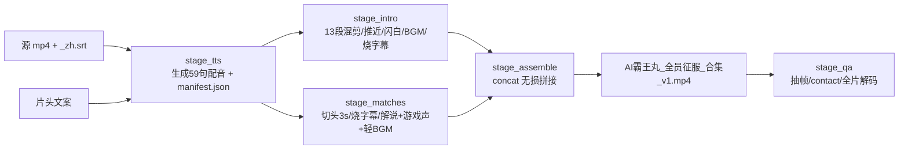

# 09_合集视频制作实战复盘_脚本参数与踩坑手册

> **归档位置**：`finaldoc\09_合集视频制作实战复盘_脚本参数与踩坑手册.md`
> **对应产物**：`videos\AI霸王丸_全员征服_合集_v1.mp4`
> **制作脚本**：`videos\_build\produce.py`
> **生成日期**：2026-11-22
> **文档定位**：这是 07（录像生成流水线）与 08（剪辑师资产手册）的**落地执行篇**。07 讲录像是怎么被生产出来的，08 讲资产怎么在剪辑软件里用，本篇记录**如何真正把这些资产变成一条成片**——包括完整脚本、参数含义、踩过的坑与修复方法，供后续制作更完整视频时直接复用。
>
> **版本提示（2026-11-22 晚追加）**：第一至十一章记录的是 **v1**（字幕压在画面上、成片 318 MB）。根据用户反馈已产出 **v2**（上方画面 + 下方独立解说条、成片 97 MB）。**最新参数与新增踩坑见第十二章，同名参数以第十二章为准。**

---

## 一、成果快照（v1 基线）

| 项目 | 实测值 |
| :--- | :--- |
| 成片路径 | `videos/AI霸王丸_全员征服_合集_v1.mp4` |
| 总时长 | **492.39 秒**（约 8 分 12 秒） |
| 分辨率 / 帧率 | 1280×720 / 30 fps（恒定） |
| 文件大小 | 332,987,963 字节（约 318 MB） |
| 视频编码 | H.264（libx264, veryfast, CRF 20；片头烧字幕段 CRF 19） |
| 音频编码 | AAC 192 kbps / 48 kHz / 立体声 |
| 首帧 | 已修正为实机对战画面 + 大字幕，可直接做封面（非黑屏） |
| 解码校验 | 全片 `ffmpeg -f null -` 无错误输出 |

### 1.1 分段时长拆解

| 段落 | 素材 | 时长 | 说明 |
| :--- | :--- | ---: | :--- |
| 片头 | 13 段跨角色高能镜头混剪 | 66.13 s | 用户提供的 260 字文案做旁白 |
| 对局 1 | haohmaru vs 王虎 | 119.11 s | 源 122.11 s − 切头 3 s |
| 对局 2 | haohmaru vs 加尔福特 | 87.58 s | 源 90.58 s − 切头 3 s |
| 对局 3 | haohmaru vs 地震 | 143.03 s | 源 146.03 s − 切头 3 s |
| 对局 4 | haohmaru vs 牙神幻十郎 | 76.51 s | 源 79.51 s − 切头 3 s |
| **合计** | — | **492.36 s** | 与成片 492.39 s 一致（封装对齐误差 0.03 s） |

### 1.2 配音生成量

- TTS 音频文件共 **59 个**：片头 13 句 + 四场对局 46 句（王虎 12、加尔福特 9、地震 12、牙神 9）。
- 对局中因原字幕时间窗短于配音时长而**加速**的句子：王虎 6/12、加尔福特 5/9、地震 6/12、牙神 5/9，最大加速比 **1.66×**（脚本上限设为 1.9×，未触顶）。

---

## 二、环境与依赖清单

| 依赖 | 用途 | 备注 |
| :--- | :--- | :--- |
| `ffmpeg` / `ffprobe` | 切片、滤镜、烧字幕、拼接、混音、抽帧质检 | 需在 PATH 中；本脚本直接调用命令名 |
| Python 3.x | 编排整个流水线 | 脚本用 `bash -lc` 执行字符串命令，故在 Git Bash 环境运行 |
| `edge-tts` | 微软在线中文 TTS | 安装：`pip install edge-tts`；需联网 |
| `numpy` | 音频矩阵混音、程序化 BGM 合成 | 安装：`pip install numpy` |
| 字体 `Microsoft YaHei` | 字幕字体 | Windows 系统自带；通过 `force_style='FontName=Microsoft YaHei,...'` 引用 |
| Git Bash | 运行 `python produce.py <stage>` | 脚本内 `run()` 对字符串命令走 `bash -lc` |

**不需要**：Premiere / 剪映 / DaVinci 等 GUI 剪辑软件。整条流水线是命令行全自动的，08 文档里的手工导入步骤在本方案中由脚本替代。

---

## 三、输入资产与目录约定

### 3.1 主对局素材（成片正文）

```
videos/
├── 20261122_195536_haohmaru_vs_wanfu_VICTORY.mp4        + _zh.srt + _commentary.json
├── 20261122_190548_haohmaru_vs_galford_VICTORY.mp4      + _zh.srt + _commentary.json
├── 20261122_185614_haohmaru_vs_earthquake_VICTORY.mp4   + _zh.srt + _commentary.json
└── 20261122_172942_haohmaru_vs_genjuro_VICTORY.mp4      + _zh.srt + _commentary.json
```

源视频规格实测：H.264 / **320×224** / 48 kHz AAC / 时长约 79–146 s。
320:224 = 10:7 ≈ 1.4286，是 Neo Geo 原生比例，这决定了后面画幅处理策略（见 6.1）。

### 3.2 片头素材池（跨角色 KO / 庆祝镜头）

脚本 `INTRO_CHUNKS` 里指定的 13 个来源（每个只取数秒）：

| 素材角色 | 文件名片段 | 用途 |
| :--- | :--- | :--- |
| 柳生十兵卫 | `haohmaru_vs_jubei` | 开场第一帧（取 4.2 s，实机画面） |
| 千两狂死郎 | `haohmaru_vs_kyoshiro` | 黄金年代 |
| 服部半藏 | `haohmaru_vs_hanzo` | 硬核格斗巅峰 |
| 霸王丸镜像 | `haohmaru_vs_haowmaru` | 深度强化学习 / 自主进化（用两次） |
| 莱因哈特 | `haohmaru_vs_sieger` | 专家混合模型 |
| 查姆查姆 | `haohmaru_vs_chamcham` | 海量实机对弈 / 结尾（用两次） |
| 不知火幻庵 | `haohmaru_vs_genan` | 招式破绽 |
| 牙神幻十郎 | `haohmaru_vs_genjuro` | 宿敌（取 28.66 s 的 KO 段） |
| 罗将神水姬 | `haohmaru_vs_mizuki` | 终极 Boss |
| 娜可露露 | `haohmaru_vs_nakoruru` | 格挡升龙重斩 |
| 橘右京 | `haohmaru_vs_ukyo` | 全员征服 |

### 3.3 `_build/` 中间产物目录

```
_build/
├── produce.py            # 唯一主脚本（约 420 行）
├── manifest.json         # 时间轴总表：片头分镜 + 四场对局逐句配音时长/变速/字幕时间
├── tts/*.mp3             # 59 个 TTS 原音频（缓存，可断点续跑）
├── wav/*.wav             # 转码后的单声道配音、游戏原声提取、各段混音成品
├── sub/*.srt             # 烧录用字幕（片头 1 个 + 对局 4 个）
├── segments/*.mp4        # 无声画面段、拼接中间体、各段带声音成品、拼接列表 txt
└── qa/*.png              # 抽帧、contact sheet、首帧检查图
```

---

## 四、流水线全景



### 4.1 阶段命令与依赖

```bash
cd "videos/_build"
python produce.py tts       # ① 生成 TTS + manifest（耗时最长，联网）
python produce.py intro     # ② 渲染片头（依赖 ①）
python produce.py matches   # ③ 渲染四段对局（依赖 ①）
python produce.py assemble  # ④ 拼接成片（依赖 ②③）
python produce.py qa        # ⑤ 抽帧质检（依赖 ④）
python produce.py all       # 一口气跑完全部阶段
```

**关键设计：每个阶段都读 manifest.json 或磁盘缓存，可以单独重跑。** 这是反复调字幕大小、改首帧时不被迫重新生成 59 句配音的原因。

---

## 五、`produce.py` 逐段解析

### 5.1 全局参数（文件顶部）

| 变量 | 当前值 | 含义 / 修改影响 |
| :--- | :--- | :--- |
| `W, H, FPS` | `1280, 720, 30` | 输出画幅与帧率。改这里需同步检查 `render_silent` 里前景 `scale=1028:720` 的比例 |
| `SR` | `48000` | 音频采样率，须与源 AAC 一致 |
| `VOICE` | `zh-CN-YunjianNeural` | edge-tts 激情男声，适合电竞解说与史诗旁白 |
| `INTRO_RATE` | `+8%` | 片头旁白语速，稍快更震撼 |
| `MATCH_RATE` | `+6%` | 对局解说语速 |
| `TRIM_HEAD` | `3.0` | **每场对局切掉的片头秒数**（黑场 / ukyo 片头） |
| `SUB_STYLE` | `FontSize=32` | 正片字幕样式（详见 6.2） |
| `SUB_STYLE_INTRO` | `.replace("FontSize=32","FontSize=32")` | 片头字幕样式。**当前是恒等替换（历史残留）**，片头与正片同字号；如需区分，把右侧改成 `"FontSize=36"` 之类即可 |
| `INTRO_CHUNKS` | 13 个三元组 | `(字幕文本, 素材文件名, 素材内起点秒)`，片头分镜表 |
| `MATCHES` | 4 个四元组 | `(内部 key, 文件名, 中文角色名, 英文标识)` |

### 5.2 工具函数

| 函数 | 作用 | 技术要点 |
| :--- | :--- | :--- |
| `run(cmd)` | 统一执行命令 | 字符串命令走 `bash -lc`；失败时打印最后 3000 字符并抛异常，避免静默出错 |
| `dur(path)` | 用 ffprobe 读时长 | 返回 float，解析失败返回 0.0 |
| `sec2srt(t)` | 秒 → `HH:MM:SS,mmm` | 生成 SRT 时间轴 |
| `parse_srt(path)` | 解析 `_zh.srt` | 用 `utf-8-sig` 去掉 BOM；返回 `[(start,end,text), ...]` |
| `wav_read / wav_write` | numpy ↔ 16bit PCM WAV | 内部统一 float32 [-1,1]，写回时转立体声 |
| `mp3_to_wav(mp3, wav, rate)` | TTS 变速转 WAV | `atempo` 变速 + `aresample=48000` + 单声道 |
| `mix_track(total, clips)` | 按时间偏移叠加音频 | `clips = [(offset_sec, mono_array), ...]`，数组越界自动裁剪 |
| `synth_bgm(total, seed)` | **程序化合成 BGM** | 110/164.81/220 Hz 铺底 + 0.62 s 间隔的指数衰减鼓点 + 结尾 3 s 上升 riser，首尾 fade。无需版权音频文件 |
| `ass_filter(srt, style)` | 生成 ffmpeg 字幕滤镜串 | `subtitles=xxx.srt:force_style='...'` |
| `render_silent(...)` | 渲染无声画面段 | 模糊放大底 + 居中前景；片头额外加 `zoompan` 推近与 `eq` 提对比；`no_fadein` 保证首帧不黑 |
| `render_match(...)` | 渲染对局画面并烧字幕 | 输入加 `-ss TRIM_HEAD` 实现切头；字幕样式用 `SUB_STYLE` |
| `mux(video, audio, out)` | 视频流 copy + 音频 AAC 重编码 | `-shortest` + `+faststart` |

### 5.3 `stage_tts()` —— 配音与总时间轴

执行两件事：

1. **批量生成 TTS**（带断点续跑）
   - 遍历 `INTRO_CHUNKS` 与四份 `_zh.srt`，构造 59 个任务。
   - 文件已存在且 >1000 字节则跳过 → 重跑极快。
   - 失败重试 6 次，退避 `3 + attempt*2` 秒（应对在线服务限流/断流）。
2. **构造 `manifest.json`**
   - 片头：`cursor` 逐句累加 `dur + 0.34 s` 间隔，得到每句字幕起止与素材起点。
   - 对局：把原 SRT 时间全部减去 `TRIM_HEAD`；落在切掉区间内的句子（时长 <0.2 s）**直接丢弃**；再按配音实际时长重算字幕终点。

**变速公式**（对局）：

```
avail = max(1.0, (b - 3) - (a - 3) - 0.15)
rate  = min(raw / avail, 1.9)        # raw 为 TTS 原始时长
final = raw / rate
sub_end = min(b - 3, a - 3 + final + 0.3)
```

### 5.4 `stage_intro()` —— 片头混剪

1. 写 `sub/intro.srt`（每句一个镜头，时间来自 manifest）。
2. 对 13 个 chunk 逐个 `render_silent(..., intro=True, no_fadein=(i==0))`。
3. 用 `segments/intro_list.txt` + `concat` 无损拼成 `intro_video.mp4`。
4. 烧录字幕 → `intro_video_sub.mp4`（CRF 19）。
5. 把 13 段 TTS 按各自 `start` 叠成旁白轨，与 `synth_bgm()` 合成的 BGM 按 `voice*1.0 + bgm*0.55` 混音 → `wav/intro_mix.wav`。
6. `mux()` → `segments/intro_final.mp4`（66.13 s）。

### 5.5 `stage_matches()` —— 四场对局

对每场：

1. 生成 `sub/<key>.srt`（时间来自 manifest，已切头）。
2. `render_match()`：输入 `-ss 3.0` 切头 → 模糊底 + 居中画面 + 烧字幕 → `segments/<key>_video.mp4`。
3. 配音轨：各句 WAV 按变速 `rate` 转码后按 `start` 叠加。
4. 游戏原声：从切头后的视频提取，`gain=0.26`（压低给解说让路）。
5. 轻 BGM：`synth_bgm(total, seed=11) * 0.16`。
6. 混合：`voice*1.05 + game + bgm`，写 `wav/<key>_mix.wav` 后 `mux()`。

### 5.6 `stage_assemble()` / `stage_qa()`

- **assemble**：按 `intro, wanfu, galford, earthquake, genjuro` 顺序写 `final_list.txt`（**必须用 basename**，见坑 P3），`concat -c copy` 无损拼接，`+faststart` 便于在线播放。
- **qa**：抽取 9 个时间点单帧 + `select='not(mod(n,1200))',scale=320:180,tile=4x3` 生成 contact sheet；再用 `ViewImage` 人工检查字幕清晰度与黑帧。

---

## 六、关键工程决策

### 6.1 画幅：模糊放大底 + 居中原生画面

源是 320×224（10:7）。直接拉伸会变形，直接裁切会丢动作。方案：

```
[0:v]split=2[base][fg0];
[base]scale=1280:720:force_original_aspect_ratio=increase,crop=1280:720,
      boxblur=20:2,eq=brightness=-0.30:saturation=0.5[bg];
[fg0]scale=1028:720:flags=lanczos[fg];          ← 1028/720 ≈ 1.428，保持原生比例
[bg][fg]overlay=(W-w)/2:(H-h)/2
```

效果：街机画面占满高度、左右留黑处填充该帧的模糊暗化版本，既不变形也不空旷，且视觉焦点自然落在中间。

### 6.2 字幕：字号 32 是实测平衡点

`force_style` 关键项：

```
FontName=Microsoft YaHei
FontSize=32
PrimaryColour=&H00FFFFFF        ← 白字
BorderStyle=3                   ← 不透明底 + 描边模式
BackColour=&H78000000           ← 半透明黑底（0x78 alpha）
Outline=2, Shadow=0
Alignment=2                     ← 底部居中
MarginV=26
Encoding=1
```

- 最初用 52/58 号字，实测**盖住大半屏**，游戏看不清；
- 26 号字在手机上偏小；
- **32 号字**既能手机清晰阅读，又保留大部分画面；
- 片头句子按语义拆成 13 个短句（每句一个镜头），避免长句自动折行产生难看的断行。

### 6.3 配音与字幕时长对齐

TTS 生成的自然时长与原 SRT 时间窗不一致。策略是**以原时间窗为准，反向给音频变速**（`atempo`），上限 1.9× 防止声音过尖。这样字幕不会早消失、解说也不会压到下一句。片头则是反过来：**以配音时长为准**排画面，每个镜头长度 = 该句配音 + 0.34 s 呼吸间隙。

### 6.4 音频三层结构与响度

| 段落 | 人声 | 游戏原声 | BGM |
| :--- | :--- | :--- | :--- |
| 片头 | `voice * 1.0` | 无 | `synth_bgm * 0.55` |
| 对局 | `voice * 1.05` | `game * 0.26` | `synth_bgm(seed=11) * 0.16` |

实测响度：均值约 **−25 dB**、峰值约 **−5 dB**，无削波。验证命令：

```bash
ffmpeg -ss 20 -t 3 -i "成片.mp4" -vn -af volumedetect -f null - 2>&1 | grep -E "mean_volume|max_volume"
```

注意 `-vn` 不能省，否则滤镜应用到视频流会报错/无输出。

### 6.5 片头节奏设计

- 13 句文案 = 13 个镜头，每句配一个**不同角色**的 KO / 庆祝高能片段（跨角色混剪制造“全员”感）。
- 每个镜头叠 `zoompan` 缓慢推近（z 上限 1.075）+ 对比度/饱和度提升，营造史诗感。
- 镜头间 0.14 s 淡入淡出；**第一段禁用淡入**以保证首帧可见（见坑 P7）。
- BGM 结尾 3 s 上升 riser，把情绪递送到第一场对局。

---

## 七、踩坑与修复记录（P1–P11）

| 编号 | 现象 | 根因 | 修复 |
| :---: | :--- | :--- | :--- |
| P1 | TTS 批量生成中途断流，部分 mp3 缺失 | 在线服务限流 | 加 6 次重试 + 递增退避；已存在文件跳过，实现断点续跑 |
| P2 | ffmpeg 报参数错误 | `-ss 1.0` 作为**单个字符串**传入 subprocess，ffmpeg 收到带空格的参数名 | 拆成 `["-ss", "1.000"]` 两个元素；`ss = ["-ss", ...] if start>0 else []` |
| P3 | concat 拼接报“找不到文件” | list 文件里写的是 `segments/xxx.mp4`，但相对路径**以 list 文件所在目录为基准**，变成 `segments/segments/xxx.mp4` | 列表写在 `segments/` 内并只用 `os.path.basename(p)` |
| P4 | 字幕盖住大半游戏画面 | 字号 52/58 过大 | 实测对比 26/32/38，定为 32 + 半透明黑底 |
| P5 | 长句字幕自动折行难看 | 一个字幕块文字太长 | 按语义拆成短句，每句对应一个镜头/时间点 |
| P6 | 切头 3 s 后首句字幕变成 0 长度段 | 原 SRT 时间减去 3 s 后 start/end 都为 0 | 若 `b2-a2 < 0.2` 则整句丢弃 |
| P7 | 成片第 0 帧全黑，无法做封面 | `fade=t=in` 让首帧 alpha 为 0 | 增加 `no_fadein` 参数，第一段只加淡出 |
| P8 | 首帧虽不黑但是绿色加载画面 | 片头第一个 chunk 素材起点设在 1.0 s（源片头） | 起点改为 4.2 s（实测为正常对战画面），与“切掉片头 3 s”的要求一致 |
| P9 | 音画不同步 / 解说压下一句 | TTS 自然时长与 SRT 时间窗不一致 | 以时间窗为准反向 `atempo` 变速，上限 1.9× |
| P10 | 解说间空白显得冷场 | 只有人声和游戏声 | 加程序化轻 BGM 铺底（无需外部音频资产） |
| P11 | `volumedetect` 无输出 | 未加 `-vn`，滤镜被应用到视频流 | 加 `-vn` 只处理音频 |

### 额外备忘

- `SUB_STYLE_INTRO` 目前是 `replace("FontSize=32", "FontSize=32")`，属于**恒等替换的历史残留**。想吃“片头字更大”的效果时，把右侧改为 `"FontSize=36"` 即可，其它样式自动继承。（v2 已废弃此变量，改用 ASS 文件，见第十二章。）
- `run()` 的 `quiet` 形参当前未使用，保留不影响运行。
- 输出文件名硬编码为 `AI霸王丸_全员征服_合集_v1.mp4`（在 `stage_assemble` 与 `stage_qa` 各一处）。做 v2 时建议改成变量 `OUT_NAME`，避免遗漏。（v2 已提取为全局常量，见第十二章。）

---

## 八、参数调整速查矩阵（改什么 → 改哪里 → 重跑什么）

| 需求 | 修改位置 | 需重跑阶段 |
| :--- | :--- | :--- |
| 字幕更大/更小 | `SUB_STYLE` 的 `FontSize`（片头另改 `SUB_STYLE_INTRO`） | `intro` + `matches` + `assemble` |
| 切掉更多/更少片头 | `TRIM_HEAD` | `tts` + `matches` + `assemble` |
| 换配音音色 | `VOICE` | 删除 `tts/` 后 `tts` + 后续全部 |
| 解说语速 | `INTRO_RATE` / `MATCH_RATE` | 删除 `tts/` 后 `tts` + 后续全部 |
| 改片头文案/分镜/镜头起点 | `INTRO_CHUNKS` | `tts` + `intro` + `assemble` |
| 换对局素材 | `MATCHES` | `tts` + `matches` + `assemble` |
| 改 BGM 强度 | `stage_intro` / `stage_matches` 中的 `bgm * 系数` | 对应阶段 + `assemble` |
| 改游戏原声音量 | `stage_matches` 中 `game_audio(..., 0.26)` | `matches` + `assemble` |
| 仅改首帧 | 对应 chunk 的素材起点 / `no_fadein` | `intro` + `assemble` |
| 输出 v2 文件名 | `stage_assemble` 与 `stage_qa` 中的 `out` 路径 | `assemble` + `qa` |

**经验法则**：TTS 是最慢且联网的阶段，能不删 `tts/` 就不删。绝大多数视觉调整只需重跑 `intro` / `matches` + `assemble`，一两分钟即可看到新版本。

---

## 九、质检清单（每版必做）

1. **分段时长核对**：`ffprobe` 各 `_final.mp4` 与成片，时长之和应一致。
2. **首帧检查**：`ffmpeg -ss 0 -i 成片 -frames:v 1 qa/cover.png`，必须是实机画面 + 字幕，不能黑屏/加载画面。
3. **抽样帧检查**：`python produce.py qa` 生成 contact sheet，用 `ViewImage` 看是否有黑帧、字幕遮挡、布局破损。
4. **切头验证**：每个对局开头 0.5 s / 3.2 s 各抽一帧，确认无 ukyo 片头残留。
5. **响度检查**：片头与对局各取一段跑 `volumedetect`，均值约 −25 dB、峰值 <−3 dB。
6. **全片解码**：`ffmpeg -v error -i 成片 -f null -`，无输出即通过。
7. **字幕可读性**：至少在 1280×720 与手机缩略两种尺寸下各看一帧，确认 32 号字可读。

---

## 十、给“更完整视频”的扩展路线

基于 v1 的架构，后续可直接扩展的方向（按成本从低到高）：

1. **补齐 16 场对局**：`MATCHES` 现在是 4 场。从 `finaldoc/00` 的验收矩阵可拿到全部 16 位角色与文件名；把剩下 12 场按同样格式加入列表，`tts → matches → assemble` 即可。预计成片约 30 分钟，建议按“角色篇”分集输出而非单文件。
2. **分离片头为独立视频**：把 `stage_intro` 的输出单独交付，作为各分集通用片头。
3. **章节化输出**：用 ffmpeg `-metadata` 或后续加 MP4 chapter，为每场对局打章节标记，方便跳转。
4. **双语字幕**：`_en` 版解说词已在 08 文档中，可为每句加一行英文 SRT，用 `force_style` 区分颜色/位置。
5. **正式 BGM**：当前 `synth_bgm()` 是程序化占位音乐，无版权风险但较单调。商用时替换为授权音轨，保留三段混音比例即可。
6. **封面独立生成**：用户既有偏好是封面由图像生成能力独立制作（不裁视频截图）。可先生成封面图，再用 `-stream_loop -1 -i cover.png` 做 2 s 片前静帧，或仅作为发布封面图单独交付。
7. **脚本增强建议**：
   - 把 `OUT_NAME` 提为全局常量，方便版本迭代；
   - 在 `manifest.json` 里记录脚本版本与参数快照，避免版本错配；
   - 增加 `stage_verify` 自动校验每段配音是否落在对应字幕窗口内。

---

## 十一、附录：关键代码片段（可直接复制改造）

### A. TTS 断点续跑 + 退避重试

```python
for tid, text, rate in tasks:
    p = f"tts/{tid}.mp3"
    if not os.path.exists(p) or os.path.getsize(p) < 1000:
        for attempt in range(6):
            try:
                await edge_tts.Communicate(text, VOICE, rate=rate).save(p)
                if os.path.exists(p) and os.path.getsize(p) > 1000:
                    break
            except Exception as e:
                await asyncio.sleep(3 + attempt * 2)
        else:
            raise RuntimeError(f"TTS failed for {tid}")
```

### B. 切头 3 秒的时间轴对齐

```python
a2, b2 = max(0.0, a - TRIM_HEAD), max(0.0, b - TRIM_HEAD)
if b2 - a2 < 0.2:          # 整句落在被切掉的区间内，丢弃
    continue
avail = max(1.0, b2 - a2 - 0.15)
rate  = min(raw / avail, 1.9)
final = raw / rate
sub_end = min(b2, a2 + final + 0.3)
```

### C. concat 列表必须写 basename

```python
with open("segments/final_list.txt", "w", encoding="utf-8") as f:
    for p in files:
        f.write(f"file '{os.path.basename(p)}'\n")   # 列表与视频同目录
run([FF, "-y", "-v", "error", "-f", "concat", "-safe", "0",
     "-i", "segments/final_list.txt", "-c", "copy",
     "-movflags", "+faststart", out])
```

### D. 首帧不黑 + 片头推近

```python
if intro:
    vf += (",zoompan=z='min(zoom+0.00045,1.075)':x='iw/2-(iw/zoom/2)':"
           "y='ih/2-(ih/zoom/2)':d=1:s=1280x720:fps=30")
    vf += ",eq=contrast=1.14:saturation=1.18"
if clip_dur > 0.4:
    fo = min(0.14, clip_dur / 4)
    if no_fadein:          # 第一段：只有淡出，没有淡入
        vf += f",fade=t=out:st={clip_dur-fo:.3f}:d={fo:.3f}"
    else:
        fi = min(0.14, clip_dur / 4)
        vf += f",fade=t=in:st=0:d={fi:.3f},fade=t=out:st={clip_dur-fo:.3f}:d={fo:.3f}"
```

### E. 程序化 BGM（鼓点 + 铺底 + 结尾 riser）

```python
pad = 0.055 * (np.sin(2*np.pi*110*t) + np.sin(2*np.pi*164.81*t) + np.sin(2*np.pi*220*t))
pad *= (0.72 + 0.28 * np.sin(2*np.pi*0.22*t))
for st in np.arange(0.0, total, 0.62):          # 每 0.62 秒一拍
    tt = np.arange(L) / SR
    f = 95 * np.exp(-tt*7) + 46
    drum[i0:i1] += 0.42 * (np.sin(2*np.pi*f*tt)*np.exp(-tt*13)
                           + rng.normal(0,1,L)*np.exp(-tt*34)*0.22)
# 结尾 3 秒上升音
st = max(0.0, total - 3.0)
f = 180 + 900 * (tt / max(0.001, total - st)) ** 2
riser[i0:i1] = 0.09 * np.sin(2*np.pi*np.cumsum(f)/SR)
```

---

## 十二、v2 改造：分屏字幕与体积压缩（2026-11-22 晚）

### 12.1 用户反馈与改造目标

v1 交付后收到两条反馈：

1. **字幕压在游戏画面上，遮挡严重**——用户截图显示“今天，我们通过深度强化学习 Reinforcement Learning”直接盖住 KO 画面。希望改为**上方是画面、下方多出一块解说条**，两者互不遮挡。
2. **成片 318 MB 太大**——四段源视频合计仅 93.5 MB，希望成片体积接近源素材。

v2 两个目标均已达成：**字幕零遮挡、成片 97 MB**（源 93.5 MB，仅多 3.5 MB）。

### 12.2 新布局参数（覆盖前文同名参数）

| 参数 | v1 | v2 | 说明 |
| :--- | :--- | :--- | :--- |
| 布局 | 全屏画面 + 字幕压在上面 | **上方游戏区 + 下方独立解说条** | 解说条高 170 px，从 y=550 到 y=720 |
| `SUBBAR_H` / `STAGE_H` | — | `170` / `550` | 解说条 / 游戏区高度 |
| `FG_W, FG_H` | `1028, 720` | `786, 550` | 786/550 ≈ 10:7，Neo Geo 原生比例，画面完整不裁切 |
| 字幕方案 | SRT + `force_style` | **ASS 文件 + 显式 `PlayResX/Y=1280/720`** | 解决 libass 默认 288 高导致字号被放大 2.5 倍 |
| `ASS_FONTSIZE` | — | `54` | 实测渲染约 32 px，三行大字仍完全在条内 |
| 字幕断行 | 按标点 | **按不可切分单元贪心断行** | 英文单词整体保留，中文逐字累加，每行 ≤20 字 |
| `CRF` / `PRESET` | `20` / `veryfast` | `30` / `medium` | 实测码率 1.8 Mbps，画质肉眼无损 |
| `AUDIO_BITRATE` | `192k` | `128k` | 语音为主，128k 足够 |
| `OUT_NAME` | 硬编码 v1 | 全局常量 `..._v2.mp4` | 一处修改，assemble/qa 同步 |
| 片头编码 | 渲染 + 二次烧字幕 | **每段渲染时直接烧字幕** | 少一次编码，省体积且提画质 |

### 12.3 新增踩坑（P12–P17）

| 编号 | 现象 | 根因 | 修复 |
| :---: | :--- | :--- | :--- |
| P12 | SRT `FontSize=32` 渲染出约 80 px 巨字、折行溢出 | **libass 对 SRT 默认虚拟分辨率 384×288**，缩放到 720p 时字号 ×2.5；`original_size=1280x720` 参数实测无效 | 改用 ASS 文件，头部显式写 `PlayResX: 1280` / `PlayResY: 720`，字号即按真实像素生效 |
| P13 | 字幕第一行跨到游戏画面上 | 片头 `zoompan` 写在 `drawbox` **之前**，把解说条一起推近裁切，字幕条与字幕位置错位 | 拆成 `_layout_base()` 与 `_subbar()` 两步，**先 zoompan、再画解说条、最后烧字幕** |
| P14 | 英文 `Reinforcement` 被腰斩成 `Reinfo` / `rcement` | 按固定字符数硬切 | `wrap_cn()` 改为单元化贪心：英文单词/数字用正则整体保留，中文逐字累加，每行 ≤20 字 |
| P15 | 三行字幕顶部仍轻微越界 | 字号 60 + 条高 160 余量不足 | 字号降到 54、条高加到 170、`MarginV` 从 18 收到 12，三行完全落条内 |
| P16 | `volumedetect` 仍无输出 | 命令带了 `-v error`，把 volumedetect 的 info 日志也抑制了 | 响度检查时**不要加 `-v error`** |
| P17 | docstring 里写 `\N` 触发 SyntaxError | Python 把 `\N` 当 Unicode 转义 | docstring 用原始字符串 `r"""..."""` |

### 12.4 关键代码：ASS 生成与单元化断行

```python
ASS_HEADER = """[Script Info]
ScriptType: v4.00+
PlayResX: 1280
PlayResY: 720
WrapStyle: 2
ScaledBorderAndShadow: yes

[V4+ Styles]
Format: Name, Fontname, Fontsize, PrimaryColour, SecondaryColour, OutlineColour, BackColour, Bold, Italic, Underline, StrikeOut, ScaleX, ScaleY, Spacing, Angle, BorderStyle, Outline, Shadow, Alignment, MarginL, MarginR, MarginV, Encoding
Style: Default,Microsoft YaHei,{fs},&H00FFFFFF,&H000000FF,&H00000000,&H00000000,0,0,0,0,100,100,0,0,1,1,0,2,10,10,12,1

[Events]
Format: Layer, Start, End, Style, Name, MarginL, MarginR, MarginV, Effect, Text
"""

def wrap_cn(text, maxchars=20):
    """英文单词/数字整体保留，中文逐字累加；\n 由 write_ass 转成 \N"""
    if len(text) <= maxchars:
        return text
    units = re.findall(r"[A-Za-z0-9][A-Za-z0-9.\-]*|[^\sA-Za-z0-9]", text)
    lines, cur = [], ""
    for u in units:
        if cur and len(cur) + len(u) > maxchars:
            lines.append(cur); cur = u
        else:
            cur += u
    if cur:
        lines.append(cur)
    return "\n".join(lines)

def write_ass(path, items, fs=None):
    """items: [(start_sec, end_sec, text), ...]"""
    buf = [ASS_HEADER.format(fs=fs or ASS_FONTSIZE)]
    for a, b, text in items:
        def stamp(x):
            return f"{int(x//3600):d}:{int(x%3600//60):02d}:{x%60:05.2f}"
        buf.append(f"Dialogue: 0,{stamp(a)},{stamp(b)},Default,,0,0,0,,"
                   f"{text.replace(chr(10), chr(92)+'N')}\n")
    open(path, "w", encoding="utf-8").write("".join(buf))
```

### 12.5 压缩效果实测

| 指标 | v1 | v2 | 降幅 |
| :--- | ---: | ---: | ---: |
| 成片大小 | 317.56 MB | **97.0 MB** | −69% |
| 视频码率 | ≈5414 kbps | ≈1820 kbps | −66% |
| 相对源素材（93.5 MB） | 3.4× | **1.04×** | 基本持平 |
| 片头段 | 更大（二次编码） | 10.40 MB | — |
| 四场对局 | — | 22.63 / 15.61 / 29.61 / 18.72 MB | — |
| 画质 | CRF 20 | CRF 30 + medium | 肉眼无差别（抽帧对比确认） |
| 时长 | 492.39 s | 492.39 s | 不变 |

### 12.6 v2 重跑速查

```bash
cd "videos/_build"
# TTS 与 manifest 未变，直接用缓存；只重渲染画面与音频
python produce.py intro       # 约 20 s
python produce.py matches     # 约 2.5 min
python produce.py assemble    # < 5 s
python produce.py qa
```

常见调整：

| 需求 | 改哪里 | 重跑 |
| :--- | :--- | :--- |
| 字幕字号 | `ASS_FONTSIZE` | `intro` + `matches` + `assemble` |
| 画面/解说条比例 | `SUBBAR_H`、`FG_W/FG_H` | `intro` + `matches` + `assemble` |
| 每行字数（影响行数） | `wrap_cn(maxchars=...)` | `intro` + `matches` + `assemble` |
| 再压小/再清晰 | `CRF`（+2 更小，−2 更清晰） | `intro` + `matches` + `assemble` |
| 输出文件名 | `OUT_NAME` | `assemble` + `qa` |

### 12.7 v2 质检补充项

- 三行字幕帧（如片头 18 s）逐行核对：每行都必须在 y≥550 的深色条内。
- 英文长句（`Reinforcement Learning`）必须完整、不腰斩。
- 首帧（0 s）应为实机画面 + 条内字幕，可作封面。
- contact sheet 12 帧全部检查“上方画面 / 下方条”的分隔线是否一致，无黑帧。
- 成片体积与源素材对比（当前 97 MB vs 93.5 MB）。

---

## 十三、v3 改造：BGM 去打击化（2026-11-22 深夜）

### 13.1 用户反馈与改造目标

用户反馈片头"咚咚咚"持续敲击"太吓人，心脏病要犯了"。根因是 v1/v2 的 `synth_bgm()` 用程序化合成：每 `beat=0.62s` 一击，含 `95*exp(-7t)+46` Hz 的下滑正弦 + 高斯白噪声瞬态，再加结尾 3 秒的上升冲击（riser）——这类**强瞬态 + 固定周期 + 宽带噪声**的组合会制造持续的压迫感，66 秒片头尤其明显。

改造目标：**保留氛围感，彻底去掉打击瞬态与噪声冲击**。

### 13.2 新 BGM 设计（`synth_bgm` 整体重写）

| 要素 | 旧版（v1/v2） | 新版（v3） |
| :--- | :--- | :--- |
| 主体 | 110/164/220Hz 常驻正弦 + 0.22Hz 慢调制 | **Am→F→C→G 四和弦循环**，每和弦 4s、相邻交叉淡化 1s |
| 打击 | 0.62s 周期低频撞击 + 白噪声 | **完全移除** |
| 高音点缀 | 结尾 3s 上升 riser | **0.9s 间隔高八度轻琶音**，指数衰减、无噪声 |
| 包络 | 全局淡入淡出 | 每个和弦自身 0.8s 淡入淡出 + 全局淡入淡出 |

和弦进行（Hz）：Am(220/261.63/329.63) → F(174.61/220/261.63) → C(261.63/329.63/392) → G(196/246.94/293.66)，每音叠加一个二倍频泛音（系数 0.12/(k+1)）增加厚度。和弦振幅系数 0.085，比旧版整体更轻，避免盖过解说。

### 13.3 验证方法：用自相关量化"鼓点感"

单听波形无法客观判断，用**周期性检测**验证打击是否消失（这一步值得固化为质检项）：

```python
# 提取成片音频前 60s，计算 50ms 窗口的 RMS 序列
rms = np.array([np.sqrt(np.mean(a[i:i+w]**2)) for i in range(0, len(a)-w, w)])
ac = np.correlate(rms-rms.mean(), rms-rms.mean(), 'full')[len(rms)-1:]
c = ac[int(0.62/0.05)] / ac[0]   # 旧鼓点周期 0.62s 处的自相关
```

实测结果：

| 版本 | 0.62s 周期自相关 | 解读 |
| :--- | ---: | :--- |
| v2（鼓点版） | 0.226 | 明显周期性冲击 |
| v3（柔和版） | **0.090** | 周期特征消失 |

配合纯 BGM 波形检查：逐 0.25s 窗口 RMS 平稳、无周期性尖峰，峰均比低（无瞬态）。

### 13.4 踩坑 P18：`numpy` 是函数内局部导入

`synth_bgm()` 中的 `np` 来自各 stage 函数内的 `import numpy as np`（第 309/378/418 行局部导入），**模块顶层没有 np**。因此在外部直接 `produce.synth_bgm(66.3)` 调试会报 `NameError: name 'np' is not defined`，但正常走 stage 渲染不受影响。调试时需要先注入：`produce.np = np`。

### 13.5 v3 重跑速查

改 BGM 只需重跑**音频相关阶段**（画面未变，但脚本里 intro/matches 会连画面一起重渲染，若只想换音可手动只跑 `stage_assemble` 前的混音步骤）：

```bash
python produce.py intro && python produce.py matches && python produce.py assemble
```

`OUT_NAME` 已从 v2 改为 `AI霸王丸_全员征服_合集_v3.mp4`，保留 v2 供对比。成片 97 MB / 492.39 s / 1280×720 / 30fps，全片解码无错，首帧仍为实机封面。

---

## 十四、英文版制作：资产复用与脚本隔离（2026-11-22 深夜）

### 14.1 需求与思路

用户指出 `_en.srt` 英文字幕已存在，要求出一版英文视频。核心判断：**英文字幕已由既有资产提供，无需翻译**——直接复用，只重做片头译文 + 英文配音。关键约束是**不能覆盖中文版成果**（v3 成片、tts/、segments/ 缓存）。

### 14.2 资产核对（动手前必做）

| 检查项 | 结果 |
| :--- | :--- |
| 英文字幕覆盖 | 四场对局全有 `_en.srt`（wanfu/galford/earthquake/genjuro） |
| 中英时间轴一致性 | **逐句时间点完全相同**（13/10/13/10 句一一对应） |
| 英文字幕长度 | 最长 141 字符（中文最长 54 字）→ 必须重新设计断行 |
| 英文声音 | `en-US-GuyNeural`（Passion 标签，对应中文 Yunjian 激情男声） |

角色名术语沿用英文字幕既有写法：Haohmaru / Genjuro Kibagami / Wan-fu / Galford / Earthquake；片头译文额外引入 Han'nya（幻庵）、Mizuki Rashojin（水姬）。

### 14.3 脚本隔离方案（`produce_en.py`）

`cp produce.py produce_en.py` 后做四处改造，全部中间产物独立，中文版零影响：

| 改造点 | 中文版 | 英文版 |
| :--- | :--- | :--- |
| 缓存目录 | `tts/ wav/ segments/ sub/ qa/` | `tts_en/ wav_en/ segments_en/ sub_en/ qa_en/` |
| manifest | `manifest.json` | `manifest_en.json` |
| 字幕源 | `*_zh.srt` | `*_en.srt` |
| 输出 | `AI霸王丸_全员征服_合集_v3.mp4` | `AI_Haohmaru_Total_Conquest_EN.mp4` |
| 声音/语速 | Yunjian / +8% / +6% | Guy / +2% / +2% |
| 片头文案 | 中文 13 句 | 英文 13 句（素材与起点秒完全保留） |

中文版 TTS 缓存不删、不重生成；英文版 49 句配音（13 片头 + 36 对局）只生成一次，重跑不重复。

### 14.4 断行函数改造（P19）

中文版 `wrap_cn(maxchars=20)` 按"中文逐字 + 英文整词"断行；英文句长达 141 字符，沿用会把一句话切成 7 行、撑爆 170px 解说条。英文版改为**纯英文单词贪心断行，`maxchars=60`**（函数名保留 `wrap_cn` 以兼容调用点）：

```python
def wrap_cn(text, maxchars=60):
    if len(text) <= maxchars: return text
    words = text.split()
    lines, cur = [], ""
    for w in words:
        if cur and len(cur) + 1 + len(w) > maxchars:
            lines.append(cur); cur = w
        else:
            cur = (cur + " " + w).strip()
    if cur: lines.append(cur)
    return "\n".join(lines)
```

实测最长 141 字符 → 3 行，逐行核对三行全部落在 y≥550 的深色条内，无腰斩、无左右溢出。

### 14.5 配音时长对齐

英文字幕时间窗与中文相同，但英文配音更长。`stage_tts` 的 `atempo` 对齐机制自动生效：

| 场次 | 句数 | 加速句数 | 平均 rate | 最大 rate |
| :--- | ---: | ---: | ---: | ---: |
| wanfu | 12 | 9 | 1.31 | 1.90 |
| galford | 9 | 7 | 1.28 | 1.71 |
| earthquake | 12 | 8 | 1.26 | 1.90 |
| genjuro | 9 | 7 | 1.28 | 1.71 |

`rate` 上限 1.9 由脚本写死；若英文再长需放宽上限，但会牺牲听感，本项目实测无需调整。片头总长 62.41s（中文版 66s）。

### 14.6 成片与质检

- 交付：`AI_Haohmaru_Total_Conquest_EN.mp4`，488.45 s / 96.8 MB / 1280×720 / 30fps / H.264+AAC。
- 全片解码无错；响度均值 −19.7~−24.3 dB、峰值 −2.2~−5.2 dB 无削波。
- 首帧为实机画面 + 英文条内字幕，可作封面；contact sheet 12 帧布局一致，无黑帧、无字幕溢出。
- 重跑命令：`python produce_en.py tts && python produce_en.py intro && python produce_en.py matches && python produce_en.py assemble && python produce_en.py qa`。

### 14.7 多语言版本扩展要点

1. **先核对字幕资产**：时间轴一致才能复用 manifest 逻辑，否则要重写对齐。
2. **脚本文件级隔离**优于参数开关——避免改错常量污染已交付版本。
3. **断行按语言特性重写**：中文逐字、英文整词、日文按词、阿拉伯语需考虑 RTL（ASS 不支持需特殊处理）。
4. **字体兼容性**：Microsoft YaHei 对英文渲染正常，无需换字体；特殊语种（泰文/阿拉伯文）需另选字体并验证 libass shaping。

---

## 十五、16 场全员版 + 结尾蒙太奇（2026-11-23）

### 15.1 需求与资产升级

`08_专业视频剪辑师指南` 更新到 **16/16 全员真 Bo3 验收版**。用户要求把全部人物视频更新进中英两个合集，并加一个精彩结尾。核对结果：16 部视频（含 8 部新录的高质量版本）全部配齐 `_zh.srt` / `_en.srt` / `_commentary.json`，时间轴逐句对齐。

**关键发现**：新版 JSON 的事件类型是 `ROUND_1_KO` / `ROUND_2_KO`（旧版是 `KO_FINISH`），结尾蒙太奇据此定位 KO 瞬间。

### 15.2 叙事顺序设计

16 场不是简单按文件名排，而是**叙事递进**：wanfu → galford → earthquake → jubei → kyoshiro → hanzo → sieger → nakoruru → chamcham → charlotte → nicotine → haowmaru → ukyo → genan → **genjuro（宿敌）→ mizuki（终极 Boss 压轴）**。与片头文案"从幻庵到牙神再到水姬"的递进呼应。

### 15.3 结尾蒙太奇（`stage_outro`）

- **取材**：从 `MATCHES` 每场的 KO 时间点（`ko - 0.45s` 起）取 1.8 秒，16 段共 **28.8 秒**快速切换。
- **字幕**：4 句结语，每句覆盖 4 个镜头（7.2 秒）。中文用 24 字行宽（专名完整、两句均衡），英文用 60 字符整词断行。
- **配音**：4 句 TTS 按 7.2 秒窗口 `atempo` 对齐（实测速率 1.06~1.41）。
- **BGM**：`synth_bgm(28.8, seed=23) * 0.5`，比正片更饱满但不盖过结语。

结语文案（中/英各 4 句）围绕"十六场征服 + AI 自主进化 + 全员征服"收束全片。

### 15.4 踩坑 P20–P21

**P20：`outro_total` 少算 4 倍**。初版写成 `len(OUTRO_LINES) * OUTRO_CLIP = 4×1.8 = 7.2s`，但结尾是 16 段镜头（28.8s）。后果：`mix_track(total, clips)` 只混合前 7.2 秒，后 21.6 秒结语无声。修复：`outro_total = len(MATCHES) * OUTRO_CLIP`。**教训：蒙太奇类片段的总时长要按"镜头段数"算，不是"字幕句数"。**

**P21：跨模块复用工具函数的 `np` 作用域**。`produce_full.py` 通过 `from produce import wav_read, synth_bgm...` 复用工具，但这些函数内部引用的 `np` 是 `produce.py` 的**模块级变量**，只在 `produce.py` 各 stage 内才 `import numpy as np`。直接调用报 `NameError: name 'np' is not defined`。修复：脚本顶部加 `P.np = np`（P 是 `import produce as P`）。这与 P18 是同一类问题的跨模块版本——**复用他人模块的工具函数时，先确认它的隐式依赖**。

### 15.5 成片与质检

| 版本 | 文件 | 时长 | 体积 |
| :--- | :--- | ---: | ---: |
| 中文完整版 | `AI霸王丸_全员征服_合集_完整版_v4.mp4` | 1769.74 s（29.5 min） | 313.9 MB |
| 英文完整版 | `AI_Haohmaru_Total_Conquest_Full_EN.mp4` | 1765.80 s（29.4 min） | 313.9 MB |

- 结构：66s 片头 + 16 场对局（切头 3s）+ 28.8s 结尾。
- 全片解码无错，响度均值 −21.4~−22.9 dB、峰值 −5.2~−5.8 dB 无削波。
- 结尾抽帧确认：KO 高能画面 + 结语字幕完全在条内，收尾帧为水姬 KO + "全员征服"。
- 重跑：先 tts（约 14 分钟，204 句），再 `intro && matches && outro && assemble && qa`（约 11 分钟）。

### 15.6 脚本隔离总览（四代脚本）

| 脚本 | 用途 | 缓存前缀 | 输出 |
| :--- | :--- | :--- | :--- |
| `produce.py` | 中文 4 场版（v3） | 无 | v3 |
| `produce_en.py` | 英文 4 场版 | `_en` | EN |
| `produce_full.py` | 中文 16 场完整版 | `_full` | v4 |
| `produce_full_en.py` | 英文 16 场完整版 | `_full_en` | Full_EN |

四套缓存完全隔离，任何一版重跑不影响其他版本。全员版通过 `import produce as P` 复用底层工具（需注入 `P.np`），只重写 stage 逻辑。

---

> **一句话总结**：整条流水线的核心不是某个 ffmpeg 特效，而是 **manifest.json 驱动的分阶段可重跑架构**——任何视觉/音频参数改动都能局部重渲染，不必重新生成全部配音。v2 证明**字幕与画面分层 + ASS 显式坐标系 + CRF 30**；v3 证明**程序化 BGM 的"吓人感"可量化消除**；英文版证明**多语言扩展靠"资产复用 + 脚本隔离 + 断行按语言重写"**；全员版证明**规模化扩展靠"叙事顺序设计 + KO 时间点驱动蒙太奇 + 四代脚本完全隔离"**。后续再做任何语种或场次扩展，沿用这一架构即可。
