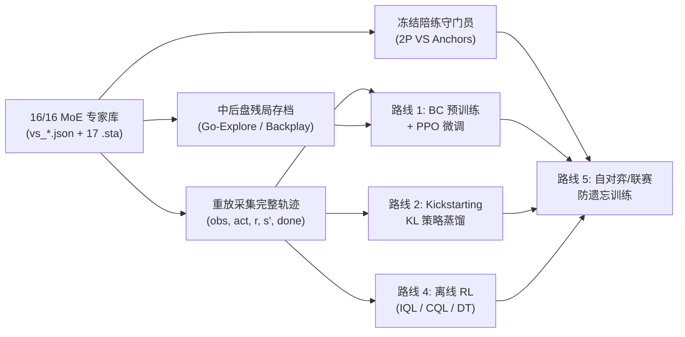

# 10_MoE 资产反哺 PPO 与强化学习进阶训练路线指南

> **文档定位**：技术架构与后续演进路线设计文档（纯方案与契约设计，暂不含具体实现代码）  
> **归档路径**：`finaldoc/10_MoE资产反哺PPO与强化学习进阶训练路线指南.md`  
> **前置基础**：16/16 全员真 Bo3 验收完成的 MoE 专家库（`models/experts/vs_*.json`）与 64 维 WRAM 实体观测环境（`src/mame_gym.py`）  
> **严谨性声明**：本文档严格区分**当前已交付资产**与**后续待验证训练路线**；所有未实跑的训练方法均作定性评估与实验设计，不作无实测支撑的胜率承诺。

---

## 一、背景：为什么 MoE 资产是救活 PPO 的最佳钥匙？

在项目早期纯 PPO 从零训练阶段，强化学习面临三个典型工程瓶颈：
1. **冷启动避战（Local Optimum Trap）**：随机探索策略一旦靠近街机高难 CPU 即遭重创（高额负奖励），策略极快塌缩到“后退发呆/龟缩拉距”，始终难以触达“格挡 → 确反重斩”的正回报区域；
2. **长视野稀疏归因**：从满血打到 KO 往往横跨数百个决策步，单靠终局胜负奖励难以准确归因到关键起手与格挡时机；
3. **单机模拟器采样吞吐受限**：MAME 在单机上受限于实时仿真速度，纯在线随机试错的时间成本高昂。

与此同时，当前已交付的 **MoE 资产** 恰好与上述痛点互补：
- **优势**：16/16 对手均已拥有实机验证通过的 Bo3 必胜专家（含多回合 `SequencePolicy` 与基于实时距离 `|dx|` 的闭环 `DistanceReactivePolicy`），能够稳定产生高质量的正回报获胜轨迹；
- **局限**：现有开环序列专家高度贴合街机 CPU 的固定状态机，面对**随机开局扰动**或**真人 2P 变招**时泛化能力有限。

因此，下一阶段的核心命题是：**以 MoE 专家作为“老师与数据生成器”，反向赋能 PPO 及其他闭环神经网络 RL，从而训练出既懂立回确反、又具备真实泛化能力的通用格斗智能体。**

---

## 二、当前可用资产盘点与数据边界

在启动任何 RL 训练前，必须明确哪些数据已经具备、哪些需要重放补采：

| 资产类别 | 当前位置 | 现状说明 | 对 RL 训练的直接作用 |
| :--- | :--- | :--- | :--- |
| **16 份验证专家配置** | `models/experts/vs_*.json` | **已就绪**（16/16 Bo3 实机验证） | 可在 `SS2RoundEnv` 中随时重放，作为“专家策略老师” |
| **17 个开局存档锚点** | `data/mame/instance/rl/state/samsho2/*.sta` | **已就绪**（16 对手 + `r1`） | 提供无菜单等待的毫秒级确定性回合重置 |
| **WRAM 实体观测环境** | `src/mame_gym.py` | **已就绪**（实体特征 + 9 维意图空间） | 提供训练与采集所需的完整观测向量 `obs` 与精准逻辑血量 |
| **现有对局文本日志** | `logs/demos/*.log` | **仅含动作与 HP，缺观测向量** | 仅用于战绩审计，**不可**直接用于 BC/Offline RL 状态输入 |
| **完整示范轨迹数据集** | *(待重放采集)* | **需重放补采**（预计几分钟可生成） | 用 16 份专家在 `SS2RoundEnv` 中重放，即可零成本录制完整 `(obs, act, r, next_obs, done, char_id)` |
| **16 部 60fps MP4 视频** | `videos/*.mp4` | **已就绪**（含双语字幕与时间轴 JSON） | 可用于未来纯视觉端到端（Image-to-Action）或多模态 VLM 研究 |

---

## 三、五大核心赋能路线（由浅入深）

### 路线 1：行为克隆（BC）冷启动 + PPO 在线微调（最推荐）
- **核心思路**：先通过监督学习（Behavior Cloning）让神经网络模仿 16 个 MoE 专家的动作分布，跳过 PPO 最痛苦的“随机探索避战期”，再接入 PPO 在线强化学习扩展泛化能力。
- **关键工程护栏**：
  1. **状态覆盖增强（Noise Injection）**：纯确定性重放只覆盖极窄的状态流形；采集示范数据时，应在开局或中间步骤注入小比例随机扰动（例如随机延迟步数或少量探索动作），让模型见过“非标准站位”下的拉回与防反；
  2. **Value Network（Critic）热身**：BC 只训练了 Actor（策略头），初始 Critic（价值头）仍是随机权重。若直接开启 PPO 联合更新，初期巨大的 Advantage 误差会瞬间冲毁刚学好的 Actor 权重。**正确做法是：PPO 启动后的前若干万步冻结 Actor、仅训练 Critic，待 Explained Variance 稳定后再以低学习率解冻 Actor 联训**。

### 路线 2：Kickstarting（策略蒸馏引导 PPO）
- **核心思路**：针对“单纯 BC 初始化后，PPO 探索噪声仍可能洗掉好习惯”的问题，在 PPO 在线训练的损失函数中引入指向 MoE 老师的 KL 散度辅助项：
  $$L_{\text{total}} = L_{\text{PPO}} + \lambda(t) \cdot D_{\text{KL}}\!\left(\pi_{\text{MoE}}(\cdot \mid s) \,\|\, \pi_{\text{PPO}}(\cdot \mid s)\right)$$
- **退火策略**：
  - 训练前期 $\lambda(t)$ 较大，强约束 PPO 紧跟 MoE 老师的起手防御与确反节奏；
  - 随着训练步数推进，$\lambda(t)$ 线性或余弦退火至 `0`，让 PPO 逐步脱离老师拐杖，针对未见过的状态与真人变招自主优化出更优解。

### 路线 3：残局课程学习（Go-Explore / Backplay）
- **核心思路**：解决长视野信用分配难题。让 MoE 专家正常推进对局，在**残局高价值节点**（如对手残血 30% 以下、角落压制、倒地起身瞬间）自动调用 `save_state` 批量沉淀一批“残局 `.sta` 锚点”。
- **课程编排**：
  1. **阶段 A**：让 PPO 先从“只差 1~2 刀即可 KO”的残局锚点出发，快速建立“进攻收割 → 胜利正回报”的因果联系；
  2. **阶段 B**：逐步将起始存档点向前倒推（残血 → 半血 → 完整开局），完成全回合连贯决策。

### 路线 4：离线强化学习（Offline RL：IQL / CQL / Decision Transformer）
- **核心思路**：绕开单机 MAME 在线采样吞吐瓶颈，把主要算力转移到纯 GPU 离线训练。
- **数据配方（关键）**：离线 RL 不能只喂全胜正样本，必须将 **MoE 专家必胜轨迹（高回报正样本）** 与 **历史 PPO 探索/失败/险胜轨迹（中低回报负样本）** 混合构建数据集 `(s, a, r, s', done)`。
- **算法选择**：
  - **IQL（Implicit Q-Learning） / CQL（Conservative Q-Learning）**：在离线数据支撑集内保守估计 Q 值，避免分布外（OOD）动作高估，将不同对局里的优秀片段“拼接（Stitching）”成更强的闭环策略；
  - **Decision Transformer**：将任务建模为序列预测，以期望回报（Return-to-Go）作为条件输入，推理时指定高目标回报以诱导高胜率打法。

### 路线 5：自对弈与联赛的“固定守门员”（Frozen Anchors）
- **核心思路**：在 2P VS 双人模式或自对弈联赛（HELT）中，纯自对弈容易陷入“非传递性旋转遗忘”或双方共同摆烂。
- **落地方式**：将现有 16 个 MoE 专家（尤其是具备实时距离感知的 `DistanceReactivePolicy`）固化为**不可变陪练池（Fixed Exploiters / Anchors）**，在 PPO 联赛训练中按固定比例抽取对局专门对抗这些专家：
  - 既充当**防退化标尺（Regression Benchmark）**，随时量化 PPO 是否退步；
  - 又迫使神经网络学会破解高强度近身压制、跳斩与升龙防反。

---

## 四、五大路线投入产出比对比

| 路线 | 工程实现难度 | MAME 采样耗时 | 泛化能力提升 | 适用阶段与定位 |
| :--- | :---: | :---: | :---: | :--- |
| **1. BC 预训练 + PPO 微调** | **低** | **极低（采集几分钟）** | **高** | **首选第一步（MVP）**，最快验证 MoE 反哺 PPO 效果 |
| **2. Kickstarting 策略蒸馏** | 中 | 中 | 高 | 配合路线 1 使用，防止微调初期策略崩溃 |
| **3. Go-Explore 残局课程** | 低~中 | 中 | 中~高 | 攻克特定难缠对手的残局收割与起身博弈 |
| **4. 离线 RL（IQL / CQL）** | 中~高 | **极低（纯 GPU 训练）** | 中~高 | 适合已有大批量正负混合轨迹后做离线提纯 |
| **5. 固定守门员（联赛）** | 中 | 高 | **极高** | 面向最终“打赢真人玩家”的长期自对弈演进 |

---

## 五、推荐的最小可行落地蓝图（MVP 三阶段设计）

若后续决定启动编码验证，建议严格按以下三个小闭环推进（每步均有明确验收门禁，避免大投入返工）：

### 阶段 1：示范轨迹重放采集（数据契约）
- **输入**：16 份 `models/experts/vs_*.json` + 16 个 `.sta` 锚点 + `SS2RoundEnv(entity_obs=True, intent_mode=True, n_intents=9)`。
- **采集策略**：每个对手重放多局（含 1 局纯确定性基准轨迹 + 若干局带轻微开局偏移/扰动的轨迹），仅保留胜局片段。
- **输出格式**：压缩 `.npz` 数据集，字段严格对齐 `mame_gym` 观测空间：
  - `obs`: `float32[N, obs_dim]`（与 `train_rl.py` 观测维度完全一致）
  - `actions`: `int64[N]`（0~8 意图 ID）
  - `rewards`: `float32[N]`
  - `dones`: `bool[N]`
  - `char_ids`: `int64[N]`（0x00~0x0F，对齐 `SS2_CHAR_ID_MAP`）

### 阶段 2：BC 预训练并导出 SB3 兼容权重
- **训练目标**：使用与 `train_rl.py` 完全同构的 SB3 `MlpPolicy` 网络结构，对 `(obs, actions)` 做带类别权重平衡的交叉熵训练（防止高频动作如 `GUARD`/`SLASH` 淹没关键低频动作如 `ANTI_AIR`）。
- **交付物**：标准 SB3 存档 `ppo_bc_init.zip`（可直接被 `PPO.load()` 与 `train_rl.py` 加载）。
- **阶段门禁**：不经过任何 PPO 微调，直接用 `ppo_bc_init.zip` 在 16 个对手上跑一遍实机评估，核查是否成功消除“避战发呆”并具备基础对抗胜率。

### 阶段 3：Critic 热身 + PPO 低学习率微调与泛化验收
- **训练流程**：
  1. 加载 `ppo_bc_init.zip`，先冻结策略头（`pi`），仅更新价值头（`vf`）完成 Critic 热身；
  2. 解冻全网络，使用较小学习率与较小 `clip_range` 开展多对手混池 PPO 微调（可选叠加 Kickstarting KL 项）。
- **三层验收门禁**（严格遵循 `AGENTS.md` 判定铁律）：
  1. **标准 CPU 池胜率**：16 个标准开局锚点 Bo3 胜率统计；
  2. **扰动鲁棒性**：在开局注入随机延迟/随机站位偏移后的胜率（检验是否真正超越开环序列）；
  3. **真人 2P 实机盲测**：通过 `.\play_demo.ps1 -Human` 由真人操作 2P 检验真实对抗体感与防反反应。

---

## 六、关键风险与避坑清单

1. **切忌直接用“开环确定性轨迹”过拟合训练 BC**：如果数据里每个对手只有一条死板轨迹，神经网络会退化成“查表记忆器”，一旦站位偏移 10 像素就会崩溃。必须加入扰动采样或优先重用 `DistanceReactivePolicy` 产生的闭环轨迹。
2. **切忌跳过 Critic 热身直接跑 PPO**：BC 得到的网络只有 Actor 有效，直接跑 PPO 极易在最初几个 Epoch 把学到的动作分布彻底打散。
3. **奖励与观测维度必须 100% 同源**：采集数据时的 `entity_obs` / `y_obs` / `hitbox_obs` / `n_intents` 开关组合必须与下游 `train_rl.py` 完全一致，否则无法无缝加载权重。
4. **坚持观战复核与成分审计（BUG-17 铁律）**：任何训练指标上升时，必须核查是否真的靠实打实 KO 获胜，而非利用超时或环境漏洞刷分。
