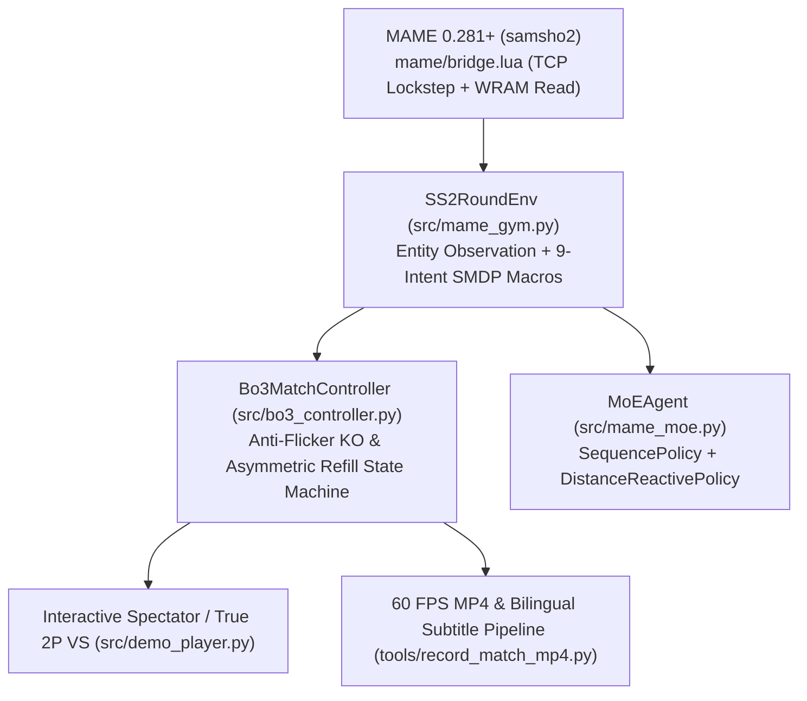

# 00. Overview & Repository Navigation (English)

> **Location**: `finaldoc/en/00_Overview_and_Navigation.md`  
> **Chinese Counterpart**: [../00_总览与全景导航.md](../00_总览与全景导航.md)

---

## 1. System Architecture at a Glance

This release packages a self-contained, zero-clutter production runtime for the **Samurai Shodown II MoE Autonomous Fighter AI**:



### Core Layers
1. **WRAM Hardware Perception (`mame/bridge.lua`, `src/mame_gym.py`)**: Reads P1/P2 entity pointers (`0x100A46` / `0x100A4A`), authoritative logical health (`UID + 0xBB`), horizontal distance (`|dx| / 512`), character ID (`UID + E_CHAR`), and hit-latch register (`0x105ED3`).
2. **Strict Bo3 Arbitration (`src/bo3_controller.py`)**: Requires 3 consecutive zero-HP steps (`zs >= 3`) to declare KO, tracks Samurai Shodown II's asymmetric round refill (loser refills to full, winner retains leftover HP), and never awards false timeout victories.
3. **MoE Policy Router (`src/mame_moe.py`, `models/experts/vs_*.json`)**: Loads per-opponent JSON configurations covering all 16 characters—combining per-round sequence policies and closed-loop distance-reactive policies (`DistanceReactivePolicy` for Mizuki and Sieger).
4. **User Entry Points**:
   - `play_demo.ps1` / `play_demo.cmd`: Spectator demo, True 2P VS Human vs. AI (`-Human`), and Free 1P Practice.
   - `record_video.ps1` / `record_video.cmd`: 60 FPS MP4 capture + bilingual `.srt` + structured `_commentary.json`.

---

## 2. Clean Release Directory Layout

```text
samsho2_ai_release/
├── README.md / README_EN.md        # Bilingual main entry guides
├── LICENSE                         # MIT License + ROM/Emulator disclaimer
├── requirements.txt                # Python dependencies
├── play_demo.ps1 / play_demo.cmd   # Spectator & Human vs. AI launcher
├── record_video.ps1 / .cmd         # Automated MP4 & subtitle recorder
├── mame/bridge.lua                 # MAME Lua TCP bridge
├── src/                            # 23 whitelisted production Python modules
├── tools/
│   ├── record_match_mp4.py         # MAME -aviwrite + FFmpeg + Commentary pipeline
│   └── export_clean_repo.ps1       # Maintainer clean-release packager
├── models/experts/                 # 16 verified vs_<char>.json + manifest.json
├── data/mame/
│   ├── cfg/                        # Pre-configured WASD + JKL/UIO keybinding templates
│   ├── movesets/haohmaru.yaml      # SMDP macro definitions
│   └── instance/rl/state/samsho2/  # 17 round-start savestate anchors (.sta)
└── finaldoc/                       # Chinese & English technical documentation
```

---

## 3. Complete English Documentation Index (10/10)

| # | English Document | Focus Area |
| :-: | :--- | :--- |
| 00 | [00_Overview_and_Navigation.md](./00_Overview_and_Navigation.md) | System architecture, release layout & navigation |
| 01 | [01_Project_Lifecycle_From_PPO_to_MoE_Sweep.md](./01_Project_Lifecycle_From_PPO_to_MoE_Sweep.md) | PPO impasse, WRAM reverse-engineering, BUG-17 rules & 16/16 sweep |
| 02 | [02_Technical_Route_Evaluation_PPO_HELT_and_Monolithic.md](./02_Technical_Route_Evaluation_PPO_HELT_and_Monolithic.md) | Qualitative evaluation of PPO, HELT self-play, Monolithic & MoE |
| 03 | [03_Match_Replay_Assets_and_Offline_RL_Guide.md](./03_Match_Replay_Assets_and_Offline_RL_Guide.md) | Replay asset tiers, DemoLogger schema & offline RL value |
| 04 | [04_Human_vs_AI_Deployment_and_Operations_Guide.md](./04_Human_vs_AI_Deployment_and_Operations_Guide.md) | True 2P VS challenger mode, WASD+JKLUIO controls & play tips |
| 05 | [05_Open_Source_Repo_Architecture_and_Release_Guide.md](./05_Open_Source_Repo_Architecture_and_Release_Guide.md) | Clean release layout, `export_clean_repo.ps1` & GitHub publishing |
| 07 | [07_Video_Capture_and_Multimodal_Commentary_Pipeline.md](./07_Video_Capture_and_Multimodal_Commentary_Pipeline.md) | MAME GDI capture, FFmpeg transcoding & adaptive commentary engine |
| 08 | [08_Video_Editor_and_Digital_Asset_Guide.md](./08_Video_Editor_and_Digital_Asset_Guide.md) | 4 practical asset workflows, FFmpeg burn-in recipes & 16/16 manifest |
| 09 | [09_Compilation_Video_Production_Postmortem_and_Playbook.md](./09_Compilation_Video_Production_Postmortem_and_Playbook.md) | Automated compilation pipeline (v1→v3/EN) & P1–P21 pitfalls |
| 10 | [10_MoE_to_PPO_and_Advanced_RL_Roadmap.md](./10_MoE_to_PPO_and_Advanced_RL_Roadmap.md) | Five MoE-to-PPO/Offline-RL pathways & 3-stage MVP plan |
