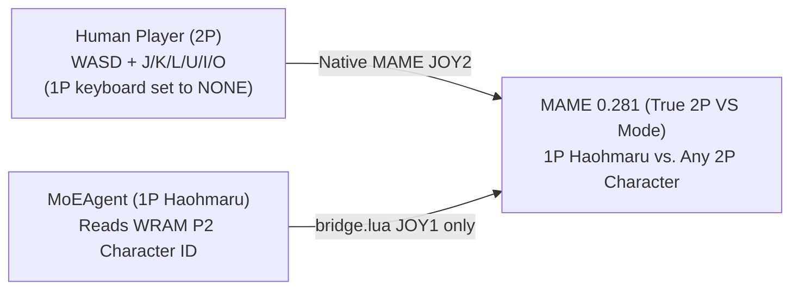

# 04. Human vs. AI Real-Time Deployment & Operations Guide

> **Location**: `finaldoc/en/04_Human_vs_AI_Deployment_and_Operations_Guide.md`  
> **Chinese Counterpart**: [../04_人机对战实机部署与实操指南.md](../04_人机对战实机部署与实操指南.md)

---

## 1. True 2P VS Architecture (Zero Input Conflict)

Earlier attempts to fight the AI inside a 1P-vs-CPU savestate failed because (a) the arcade engine ignores 2P joystick input until a 2P challenger joins, and (b) macro taps previously injected into `role=0` (1P).

This release implements **True 2P VS Human vs. AI Mode** (`src/demo_player.py: play_vs_human`), physically separating AI and human inputs:



- **No `bridge.lua` edits required**: `mame/bridge.lua`'s `release_all()` only clears fields injected by the bridge (`held`), never clearing native human 2P inputs.
- **Zero Keyboard Conflict**: `data/mame/cfg/samsho2_human_p2.cfg` explicitly maps all 1P keyboard inputs to `NONE`, while binding 2P to `WASD + J/K/L/U/I/O` (plus Arrow Keys + Numpad `1–6`).
- **Lockstep Pacing Note**: The match loop advances 2 frames per step with `1/60s` pacing (~45–60 FPS effective responsiveness) so WRAM perception and AI decisions stay synchronized; a fully asynchronous freeflow control mode remains a future roadmap item.

---

## 2. How to Launch & Play

### Mode A: True 2P VS Battle — AI 1P Haohmaru vs. Human 2P (Pick Any Character) *(Recommended)*
```powershell
.\play_demo.ps1 -Target genjuro -Human
# Or run .\play_demo.ps1 and choose option [2]
```
**What happens automatically**:
1. Installs `data/mame/cfg/samsho2_human_p2.cfg` into the `rl_vs_human` instance.
2. Enables arcade Freeplay (`DSW:64:1`) and injects **2P START** (`role=2, mask=0x04`) to trigger *"HERE COMES A NEW CHALLENGER!"*, landing directly on the **2P VS Character Select** screen.
3. AI automatically locks **1P Haohmaru**. Use **`W/A/S/D` + `J`** in the MAME window to pick **any** 2P character you like.
4. The moment the round starts, WRAM (`p2uid + E_CHAR`) detects your chosen character ID and automatically switches AI Haohmaru to the matching MoE counter-expert.
5. After the Bo3 match finishes, the window holds for **15 seconds** so you can view the full victory animation and score screen (`Ctrl+C` exits early anytime).

### Mode B: Free 1P Practice — Human 1P Haohmaru vs. Arcade CPU (AI Dormant)
Run `.\play_demo.ps1` and choose option **`[3]`**.
- Installs `data/mame/cfg/samsho2_human_p1.cfg` (`WASD + J/K/L/U/I/O` on 1P).
- AI sends **zero inputs** and never interferes with your 1P controls.

---

## 3. Default Keyboard Controls (Auto-Configured)

| Function | Primary Keys (1P & 2P) | 2P Alternate Keys |
| :--- | :--- | :--- |
| **Move / Jump / Crouch** | `W` (Up), `S` (Down), `A` (Left), `D` (Right) | Arrow Keys (`↑ ↓ ← →`) |
| **Slash (Light / Med / Heavy)** | `J` (A), `K` (B), `L` (A+B Heavy Slash) | Numpad `1` (A), `2` (B), `3` (A+B) |
| **Kick (Light / Med / Heavy)** | `U` (C), `I` (D), `O` (C+D Heavy Kick) | Numpad `4` (C), `5` (D), `6` (C+D) |

*(You can also press `Tab` inside MAME -> `Input (this machine)` to bind any USB gamepad.)*

---

## 4. Tips for Fighting the AI & Improving Policies
- **Exploiting Sequence Experts**: Most non-reactive experts follow tight frame cadences; baiting a heavy slash at max range (`get_char_reach`) and whiff-punishing or using close command throws (`<= 42px`) is the most reliable way for humans to beat the AI.
- **Closing the Loop**: Matchups where humans consistently beat an expert highlight exact state-coverage gaps that can be upgraded to closed-loop `DistanceReactivePolicy` or BC+PPO policies.
