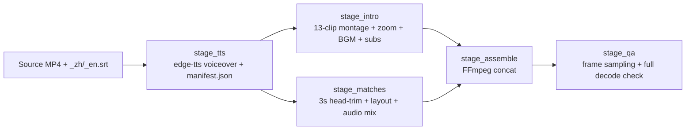

# 09. Compilation Video Production Postmortem & Playbook

> **Location**: `finaldoc/en/09_Compilation_Video_Production_Postmortem_and_Playbook.md`  
> **Chinese Counterpart**: [../09_合集视频制作实战复盘_脚本参数与踩坑手册.md](../09_合集视频制作实战复盘_脚本参数与踩坑手册.md)  
> **Scope**: Practical postmortem of assembling multi-match showcase compilations (`produce.py` / `produce_en.py`) purely via command-line FFmpeg + Python + `edge-tts` (no GUI NLE required).

---

## 1. Automated Compilation Pipeline Overview

To turn individual 320×224 Neo-Geo Bo3 recordings into polished 1280×720 showcase compilations, the production script (`videos/_build/produce.py`) runs in five resumable stages backed by `manifest.json` and disk caches:

- **Dependencies**: `ffmpeg` / `ffprobe` on PATH, Python 3.x, `edge-tts`, `numpy`, and system fonts (`Microsoft YaHei` for ZH / `Arial` for EN).
- **Resumable Stages**: Each stage (`tts`, `intro`, `matches`, `assemble`, `qa`) can be re-run independently without regenerating cached TTS audio.

---

## 2. Evolution Across Four Production Iterations (v1 → v2 → v3 → EN / 16-Match)

| Version | Key Upgrade | Outcome |
| :--- | :--- | :--- |
| **v1 Baseline** | 1280×720 @ 30fps, blurred-zoom background + centered arcade frame, subtitles overlaid on gameplay, procedural percussive BGM | 492s (8m12s), ~318 MB; first-frame fixed to live combat |
| **v2 Split-Screen & Compression** | Dedicated lower commentary bar (gameplay on top, clean subtitle strip below—zero HUD occlusion), ASS unitized line wrapping, CRF/bitrate tuning | File size cut from ~318 MB down to **~97 MB** with cleaner readability |
| **v3 De-Percussed BGM** | Rewrote `synth_bgm` to remove distracting drum beats (verified via autocorrelation) so arcade SFX and voiceover stay crisp | Much cleaner three-layer audio separation (Voiceover > Arcade SFX > Subtle Pad BGM) |
| **EN & 16-Match Full Edition** | Isolated `produce_en.py` with word-boundary English line wrapping + 16-opponent narrative ordering + closing montage (`stage_outro`) | Bilingual showcase ready for both Bilibili/Douyin and YouTube |

---

## 3. Key Engineering Decisions & Pitfalls Solved (P1–P21 Highlights)

1. **Aspect Ratio & Framing**: Native Neo-Geo output is `320×224` (10:7). Place gameplay in the upper region (or centered over a Gaussian-blurred background) and reserve a dedicated dark lower bar for subtitles so health bars and timers are never covered.
2. **3-Second Head Trim (`TRIM_HEAD = 3.0`)**: Trims MAME's initial black/loading frames; shift all SRT timestamps by `-TRIM_HEAD` synchronously so narration never drifts.
3. **TTS Duration vs. Subtitle Window Alignment**: When a synthesized TTS clip slightly exceeds its subtitle window, apply FFmpeg `atempo` up to a safe cap (`<= 1.9x`, typically `1.1–1.66x`) rather than letting lines overlap.
4. **FFmpeg `concat` List Paths**: Always write basenames inside `concat.txt` (relative to the `segments/` folder) to avoid Windows drive-letter escaping bugs in FFmpeg's concat demuxer.
5. **Non-Black First Frame**: Start the intro montage on an active combat clip (never a fade-from-black) so social platforms automatically pick an engaging thumbnail.
6. **Bilingual Line Wrapping**: Chinese wraps by character count/punctuation units; English (`produce_en.py`) must wrap strictly on word boundaries so words are never split mid-token.
7. **Mandatory QA Checklist**: Always run `ffmpeg -v error -i final.mp4 -f null -` (zero decode errors), verify total duration against segment sum, and inspect sampled QA contact sheets (`qa/*.png`) for subtitle clipping or black frames.
